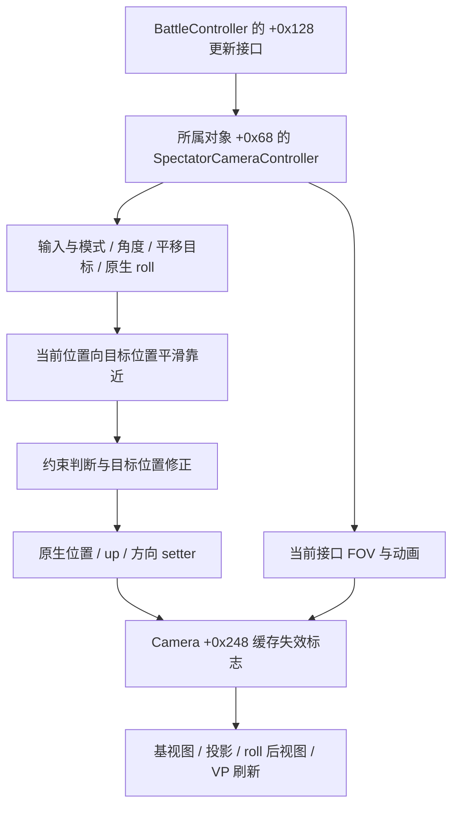

# 11.21 相机更新链与 A 步骤恢复实验方案

当前进度：第 1–4 节保留最初的只读研究和方案；第 5–6 节记录 R1 位置恢复；第 7–8 节为姿态/FOV 方案与只读核对；第 9–10 节为分别获授权的朝向、FOV 实验；第 11 节为另获授权的位置、yaw/pitch、FOV 组合恢复。各节按当时授权和证据记录，不把一次授权扩展为注入或 Hook 授权。早期“零写入”“尚未执行”描述只对应当时阶段。

日期：2026-10-18（Asia/Shanghai）。对象为本机 Windows Steam 国际版 `11.21.0.1235`，SHA-256 `5030ee4b9f6ec7db1c06efa2b92f9dd7243574be5d8d9578c118119318bc9608`。本轮重新读取 EXE 并核对哈希，进行静态分析和只读进程预检；游戏写入次数为零。工具 0.1.1 的生产读取器与界面未增加恢复功能。

## 结论

第一项值得执行的运行时修改实验是 **R1：一次提交保存的目标位置，让原生更新平滑返回并保持**。只修改已确认 SpectatorCameraController 的三个目标位置 float，保持朝向、FOV 和模式不变，借助已经定位的原生 setter 和矩阵刷新链。它检验外部目标能否被原生更新接纳、是否被输入/约束/其他逻辑覆盖。

R1 通过仅代表“固定姿态/FOV 的平滑位置返回”。**R2：瞬时位置恢复**、**R3：完整姿态/FOV 恢复**是后续独立实验。不能把缓慢靠近 A 判为即时恢复，也不能把静态定位的函数当作已成功调用的接口。

这是具体实验设计，不是写入授权或可直接运行的写入工具。用户本轮要求“先给出方案”，此前“不写内存、不注入”限制继续有效。已实现并运行的准备脚本仅只读，报告明确写 `write_ready=false`。

## 1. 新构建直接证据

以下地址均是本构建 **preferred VA**，运行时需要 `moduleBase + VA - 0x400000`；对象偏移只适用于本构建。语义名称是对指令行为的描述，不是官方 API。



### 1.1 上层调用及时间步

`BattleController` 的 `+0x128` 子接口 VFT 为 `0x37f8fb0`，slot 3 为 `0x17754b0`。RTTI 与完整子对象偏移见 [battle-controller-rtti.json](../builds/11.21.0.1235/battle-controller-rtti.json)。

`0x177572c` 读取所属对象的 `+0x68`，`0x177572f` 直接调用共同更新 `0x1bc8e80`；其 float 参数取自本次上层更新参数，没有在这个调用点乘 ReplayPlayer 的播放速率。另一分支走 `+0x2c → 0x1bc8e60`，不能混用。

该方法属于更新接口已有静态证据，但尚未追到调度器传入 dt 的最终来源或核实执行线程 ID。此前实际暂停平移证明相机更新在那个暂停场景中继续发生，不能据此给 dt 命名为固定渲染帧时长。

当前进程增加了一条只读关联：BattleController `+0x120 → AvatarContextReplay`、`+0x150 → 所属对象`、该对象 `+0x68 → 已识别的 SpectatorCameraController`；次级 VFT 也匹配。这增强了与实际更新者的联系，**仍不是引擎全局活动场景根的独立证明**。

### 1.2 共同更新的顺序

完整片段见 [camera-chain-update.txt](../builds/11.21.0.1235/camera-chain-update.txt)。

| 顺序 | 本构建地址 | 已确认行为 |
|---|---|---|
| 1 | `0x1bc8eb4 → 0x1bcd860` | 输入字节推进角度等输入状态 |
| 2 | `0x1bc8eeb → 0x1bca830` | 自由分支处理目标角度 `+0x58/+0x5c`、平滑角度 `+0x60/+0x64`，计算方向 `+0xb8..+0xc0` |
| 3 | `0x1bc8f28 → 0x1bc9b60` | 消费平移输入 `+0x9c..+0xa4`，以 dt 推进目标位置 `+0xac..+0xb4`；边界和附加区域可修正目标 |
| 4 | `0x1bc9009 → 0x1bcd300` | 原生 roll `+0x110` 参与计算 up `+0xc4..+0xcc`；按键也可能推进/重置 roll |
| 5 | `0x1bc9010..0x1bc90ac` | 读取当前位置，计算下述平滑候选 |
| 6 | `0x1bc90c3` | 调用 up setter `0xa96250` |
| 7 | `0x1bc90db` | 调用派生控制器 virtual slot 6 作约束判断 |
| 8 | `0x1bc9133` 或 `0x1bc91ac` | 调用位置 setter `0xa95710`；约束分支可能同时修正或撤回目标位置 |
| 9 | `0x1bc91cd` | 自由分支调用方向 setter `0xa92b80`，重新令 target = position + controller.direction |
| 10 | `0x1bc91df → 0x1bce3c0` | 模式切换处理；入口依赖输入字节 `+0x1c`，所以仅检查移动增量为零还不充分 |
| 11 | `0x1bc9236..0x1bc9338` | FOV 输入、动画及当前接口 FOV 同步；末尾清理部分输入 |

位置公式有直接指令支持：

`candidate = camera.position + (controller.target_position - camera.position) × dt × controller[+0xfc]`

只改变 Camera.position 时，目标仍是旧位置，后续更新会追向旧目标；只改变 Camera.direction 缓存也会被原生方向重算覆盖。外部读取没有覆盖完整调用栈，因此不宣称已经枚举所有写入者。

Spectator slot 6 是 `0x1d50610`；它可通过 `controller+0x08` 关联对象的状态，进一步调用 `0x770910`。共同更新又会检查控制器的主边界。`0x1bc9b60` 还遍历 `+0x48/+0x4c` 表示的 24 字节区域条目，在特定包含条件下调整 Z。不能用“目标位于主地图盒内”替代全部约束检查，也不在首测关闭约束。

### 1.3 相机与缓存

setter 证据：[camera-chain-setters.txt](../builds/11.21.0.1235/camera-chain-setters.txt)。缓存证据：[camera-chain-dirty.txt](../builds/11.21.0.1235/camera-chain-dirty.txt)。

- `0xa95710` 写位置 `+0x38`，末尾令 `flags(+0x248) |= 1`。
- `0xa92b80` 用位置加方向写 target `+0x44`，同样置 bit 1。因此不能只移位置而保留旧世界 target，却期待朝向不变。
- `0xa96250` 更新 up，同样置 bit 1。以上 setter 都有组件关联分支；首测维持 Camera `+0x08=+0x0c=0` 的已验证条件。
- `0xa7aee0` 检查 dirty bits：`1 → 0xa886e0` 重建基视图，`4 → 0xa8a1b0` 重建投影，`2 → 0xa8a4a0` 组合 Camera roll 得到最终 view，`8 → view×projection` 写 VP。view 与 VP 分别位于 `+0xc0/+0x140`。
- `0x15eaf10` 是 FreeCamera 的接口 FOV setter，保存 `+0x268`，乘 `+0x264` 后钳制，转到 `0xa93070 → 0xa8a580` 更新投影参数。FOV 不是只改最终投影矩阵或 `+0x2c` 即可完整恢复。

R1 的优点是让原生路径完成上述位置、方向及矩阵关系；不需要外部调用这些函数，也不回填矩阵。R2 才需要确定的游戏线程提交时机。

## 2. 本轮只读准备已做什么

脚本：[prepare_restore_1121_readonly.py](../scripts/prepare_restore_1121_readonly.py)。

```powershell
python -X utf8 -B research/scripts/prepare_restore_1121_readonly.py --out output/restore-preflight-new.json
```

脚本只接受精确 11.21 构建，检查暂停自由镜头，采集 100 次读侧一致快照；输出文件已存在则拒绝覆盖。它不启动游戏、不模拟输入、不请求进程写权限，也不生成可直接执行的写入命令。

本轮 [预检结果](../builds/11.21.0.1235/restore-readonly-preflight.json)：100 个有效样本，覆盖约 2.065 秒；所有 `+0x10..+0x2d` 输入字节及已知输入向量为零；回放时间不变；位置偏差为零；目标与位置最大距离 `0.00003433` 世界单位；FOV 当前值等于目标值；目标位于主边界内。当前机位不是此前录制的起始 A，不能把历史机位或地址直接用于后续恢复。

另外重新分析了此前用户按 W 后的原生平滑尾段：[native-settling-analysis.json](../builds/11.21.0.1235/native-settling-analysis.json)。固定目标后的 63 个异步样本覆盖约 1.32 秒，误差在 0.01–2 世界单位区间的 `log(distance)` 对墙钟时间拟合斜率约 `-3.316/s`，与读到的位置系数 `3.2222` 所代表的追赶行为相容。它不是外部恢复试验、引擎 dt 测量或速度承诺，不能据此让原生平滑承担后续精确 8 秒轨迹。

预检不证明 FOV 动画队列为空、全部约束可通过、线程提交点可用或独立活动场景根闭合；这些限制均保留在报告中。

## 3. R1：单次目标位置提交，验证平滑返回

### 3.1 具体修改边界

拟采用独立实验进程，通过 Windows 进程数据写入接口 **只提交一次连续 12 字节**：

| 项目 | 内容 |
|---|---|
| 唯一修改对象 | 当次重新确认的 SpectatorCameraController |
| 唯一修改范围 | `controller+0xac` 起三个 float32，即目标 X/Y/Z |
| 载荷 | 刚刚在同一场景保存的 `A.camera.position`，原始 float32 值 |
| 执行方式 | 一次进程数据写入；无远程函数调用、Hook 或注入 |
| 写后行为 | 立刻关闭额外写句柄；后续仅观察，没有纠正写入、自动重试或自动回滚 |
| 原生处理 | 后续更新消费目标、做约束和平滑，调用原生相机 setter、刷新矩阵 |

**一次 12 字节写入不等于原子事务。** 游戏可能在中途读取混合分量，写入前检查也不能消除检查后场景变化的竞态。本方案不暂停线程、不试图以高频抢写掩盖问题。这正是 R1 只作为人工看守的小范围验证、不能直接成为正式“恢复”按钮的原因。严格要求逐帧无中间态时，应跳过这种提交方式，等待 R2 的线程内事务方案。

### 3.2 写入前门槛

后续获得明确的“一次 12 字节数据修改”授权后，才实现独立执行器。注入/Hook/远程调用不包含在该授权中。执行器写能力默认关闭，不能从工作台普通连接自动触发。

每次尝试必须重新验证：

1. 精确 EXE 哈希、PE 架构、实际模块基址和进程创建身份。当前保存器尚未实现进程创建时间指纹，正式执行器需补齐，不能只凭 PID。
2. ReplayPlayer active、initialized、paused 有效；seek/wait/task 状态正常；时间连续静止；GameSceneController、BattleController、回放上下文和相机/RenderSystem 关联全部一致。
3. 明确确认当前画面是本地回放自由镜头。独立 engine-active-root 仍未闭合，正式无人值守接管必须先补齐。在它未闭合时，R1 只能是人工看守实验：用户刚刚在当前画面移动 A→B，工具读到同一链响应、时间仍暂停，再由用户确认后单次提交；任一关联有歧义就不写。不能把“进程中存在 ReplayPlayer”当作门禁。
4. 处于 `controller+0x10c=-1, +0x128=0`，Camera `+8/+0xc=0`；全部已识别输入字节、角度/FOV/平移增量为零；姿态/FOV/目标/实际位置至少稳定 2 秒。
5. A/B 属于同一实例代际、同一回放和相机；A 的位置数值有限、主边界内且远离边界和障碍；检查附加区域条目。用户平移经过的 A↔B 开阔段作为范围，不尝试穿墙或任意远距离传送。
6. A/B 相距 `0.5–3` 世界单位，姿态差不超过 `0.05°`，水平 FOV 差不超过 `0.01°`，回放时间相同。所有阈值事前固定，失败后不现场放宽。

这些检查降低选错对象的风险，不能提供线程原子性或运营方许可。权限申请、完整写入字节数和最终模式复核都需纳入执行器日志；若 Windows 写入失败或部分完成，关闭写权限并结束本次试验，不自动补写剩余分量。

### 3.3 操作与验收

| 步骤 | 执行/观察 | 通过标准与失败处理 |
|---|---|---|
| 保存 A | 暂停、松开输入，连续读至少 2 秒；保存原始位置、完整姿态、FOV、控制器状态、矩阵、时钟、身份与截图/固定地标 | 各项静置条件满足；否则继续只读定位 |
| 手动到 B | 用户只短暂平移，距离控制在 0.5–3 世界单位，松开后停稳 2 秒 | 同一链的位置响应且姿态/FOV/时间不变；有切换就整次作废 |
| 单次提交 | 写前再次校验；把 A 的位置提交为控制器目标，关闭写句柄 | 系统报告完整 12 字节；这是提交成功，不是镜头恢复通过 |
| 等待返回 | 按 50 Hz 目标频率只读采样，最多 5 秒，记录全部丢样原因 | 有效样本进入距离 A ≤0.01 世界单位；逐渐靠近如实记为平滑返回 |
| 保持 | 首次进入误差范围后持续至少 3 秒、至少 150 个有效样本 | 每个有效样本位置误差 ≤0.01、完整姿态差 ≤0.05°、水平 FOV 差 ≤0.01°，时间不变；任何有效样本越界则保持失败，不挑另一段重新判成功 |
| 画面与矩阵 | 检查眼点/view、view×projection/VP、场景与渲染相机引用；用户确认固定地标回到 A 构图 | 不能只验证刚写入的目标字段。没有画面证据时画面项单列未验证 |

矩阵阈值沿用读取器已实现的尺度相关检查：眼点和 VP 最大分量误差 ≤`0.001 + max(1, abs(position))*1e-6`，旋转正交误差 ≤`1e-4`，投影布局和宽高比检查仍需通过。另报告实际最大残差，不将该阈值解释为像素误差。暂停不等于渲染或线程停止；150 个样本也不是 150 个渲染帧。

预期结果可能为：

- **平滑返回并保持**：支持控制器目标为有效入口，可继续规划 R2；完整 A 尚未通过。
- **目标被改回 B 或改成其他值**：输入、约束或其他写入者仍在覆盖，检查对应分支；不改为持续写入。
- **目标保留 A 而相机不动**：检查该对象是否实际参与更新、dt、暂停分支和活动场景来源。
- **位置趋近 A，矩阵或画面不跟随**：检查 dirty 刷新、渲染绑定或采样阶段，不能判恢复通过。
- **回弹、转向、FOV 变化或约束修正**：当前前提不足；保存原始证据，结束本次写入试验。
- **身份改变、模式切换、异常数值或进程退出**：立即终止，用户通过正常游戏操作重新打开回放；不在旧指针上尝试回滚。

## 4. R2 与完整 A 的推进条件

### R2：固定姿态/FOV 的即时位置恢复

若需要一次更新内完成，就必须在游戏相机更新线程的确定阶段提交成套状态，而不是外部多次写字段。

新构建候选提交点已缩小到 `0x1bc900e`：输入与方向/up 计算之后、取当前 Camera.position 并计算平滑候选之前。在该阶段使控制器目标等于 A，并通过已识别的原生位置 setter 设置相机位置，再让同一次更新设置方向/矩阵；这有望消除旧目标牵引和位置平滑延迟。

该点只是静态候选，还不是可执行 Hook：必须先验证真实线程、调用频率、重入、指令边界/重定位、对象寿命、提交阶段与渲染读取的先后关系。若采用自编进程内 helper + Hook，需要单独说明并取得运行时代码修改/注入授权；本轮没有编写或安装 helper。不能用 `CreateRemoteThread` 直接调用这些内部函数来替代游戏更新线程。

R2 验收与 R1 不同：第一个已识别的完整后继相机更新就要达到 A，不能用 5 秒内平滑到达替代。无引擎帧计数或阶段证据时只能报告“首个一致读样本”，不能宣称下一帧到位。通过后重复三次 A→B→A，仍须每次独立检查身份；不自动连做。

### R3：完整姿态与 FOV

位置成功后依次加入：目标/平滑角度成套恢复、控制器原生 roll 与 Camera roll 的约定、接口 FOV 与原生动画处理。方向/up 是每次计算出的状态；当前/目标 FOV 数值相等也不证明动画无活动。不能恢复动画指针或整个对象块。每加一类状态单独验收，最后才进行完整机位保存与恢复、重开同一回放的重复性验证。

本轮最少需要用户做的事：暂时无需操作。进入写入实验前，工具会先给出当次 A/B 的具体数值、唯一 12 字节修改范围、预检结果和明确执行方式，再请求把当前只读范围扩展为 R1 的那一次数据修改。没有这一步，不执行写入。

## 5. 2026-10-18 当次执行前补充

用户已明确要求恢复新保存的位置，并确认当前仍暂停、只向右平移、没有操作鼠标和滚轮。这是本次一次性位置修改的授权，不再要求重复确认。

保存记录为 `output/captures/20261018T152922309882Z.json`。只读预检 `output/archive/2026-10-27/research/restore-r1-20261018-preflight/report.json` 读到 A→B 位移 `18.009103231360907` 世界单位，完整姿态差 `0.000058156965164257276°`，FOV 差为零；回放时间仍为 `23.61650562286377` 秒，同一进程、场景、控制器及相机链。主边界和额外位置调整区域检查通过。

此前 `0.5–3` 为实验自定范围，并非已知客户端限制。依据用户这次明确授权的纯横移，在实际写入前为本次试验预定距离上限 **25 世界单位**，执行器仍默认上限 3，只有本次命令显式选择 25。位置误差 ≤0.01、姿态差 ≤0.05°、FOV 差 ≤0.01°、5 秒内到达、保持至少 3 秒且至少 150 个有效样本等验收标准不变；不在结果失败后放宽标准。

执行器为 `research/scripts/restore_position_1121_once.py`，与只读工作台隔离。执行前的离线模拟检查 `tests/test_restore_once.py` 共 9 项通过，覆盖唯一 12 字节写入、部分写入/异常后消耗尝试次数、身份/模式/目标变化时拒绝写入及写句柄关闭。下一步执行时仍会重新完成全部实时门槛；本节本身不是实际恢复成功的证据。

## 6. 2026-10-18 R1 实测结果

本次精确构建 `11.21.0.1235` / SHA-256 `5030ee4b9f6ec7db1c06efa2b92f9dd7243574be5d8d9578c118119318bc9608`。

- 首次受限环境尝试通过全部只读预检，但 Windows `OpenProcess` 返回错误 5，未取得写入句柄，实际写入次数为零：`output/archive/2026-10-27/research/restore-r1-20261018-execution/report.json`。
- 随后通过环境权限审批，在用户同一项明确授权内重新预检，完成唯一一次 12 字节目标 XYZ 写入；进程创建身份和相机实例均未改变。未启用调试特权、注入、Hook、远程调用、线程暂停、保护属性修改，也没有修改游戏文件。
- 实际报告：`output/archive/2026-10-27/research/restore-r1-20261018-permission/report.json`；读侧时序：同目录 `after.jsonl`；汇总：同目录 `analysis.json`。报告保留完整写前检查、旧/新载荷和系统写入结果。

| 项目 | 读到的结果 |
|---|---|
| 写入入口 | 当次重新确认的 SpectatorCameraController `+0xac`，目标 XYZ，共 12 字节；系统报告完整成功 |
| 保存 A | `(-145.1414794921875, -132.6793212890625, 31.406620025634766)` |
| 起点 B | `(-127.45023345947266, -129.31069946289062, 31.4066219329834)` |
| A/B 距离 | `18.009103231360907` 世界单位 |
| 进入 ≤0.01 误差范围 | 开始写后观察的 `2.2115031` 秒处；此计时不等于精确引擎提交时间 |
| 保持 | `150` 个有效读样本，持续 `3.1129821` 秒，保持段最大位置误差 `0.0092441192` |
| 最后位置 | `(-145.14141845703125, -132.67926025390625, 31.4066219329834)` |
| 最终位置误差 | `0.0000863378166` 世界单位 |
| 姿态/FOV | 全部有效样本最大完整姿态差 `0.0000621791102°`；FOV 差始终为零 |
| 回放时间 | 所有有效样本均为 `23.61650562286377` 秒；一直暂停 |
| 采样 | 256 次尝试，252 个有效样本，4 次因相机/矩阵暂不同步丢弃 |
| 有效样本矩阵残差最大值 | 眼点 `0.0007555692`、旋转 `1.2425438e-7`、VP `0.0000075750613`，均通过既有读取器阈值 |

**读侧 R1 位置返回与保持验收通过。** 目标字段保持 A，实际 Camera.position 与视图/VP 一致向 A 返回；没有使用持续重写或回滚。这为“暂停时原生更新会消费该目标位置并刷新已关联渲染相机”的入口提供了本次运行证据，返回行为是原生平滑，不能用于声称瞬间到位或精确 8 秒匀速。

用户随后明确确认“已回到保存构图”。报告已将 `visual_match_verified` 更新为 true，并记录证据来源为用户人工确认；这不是自动截图或像素比对结果。结合位置/姿态/FOV、回放时钟、视图/VP 及保持段数据，本次固定朝向、固定 FOV 的 R1 平滑位置恢复通过数值验收与用户画面确认。

本次不是完整 A：方向/roll/FOV 的恢复、重开回放后的重复性、逐帧提交时机、独立活动场景根仍未验证。4 次异步丢样不能用来证明游戏渲染抖动，也不能据此证明逐帧没有中间态。读样本不等于渲染帧。普通工作台和发行包继续只读。

## 7. 后续 R3：姿态、FOV 与组合机位恢复方案

本节响应用户“下一步试试连朝向和 FOV 一起恢复，先给出具体实验方案”。本轮仅复核精确 EXE 哈希、分析本地 PE 指令和已保存的原始快照，没有访问游戏写权限、写游戏内存或控制游戏。先验证**可保持的平滑完整状态返回**；瞬时、逐帧同步的完整机位提交仍属于 R2 的更新线程方案。R3 不以 R2 已完成为前提，但不能宣称具有 R2 的提交时序保证。

### 7.1 本轮补齐的静态证据与边界

证据为 [pose-restore-static.txt](../builds/11.21.0.1235/pose-restore-static.txt)、[pose-animation-static.txt](../builds/11.21.0.1235/pose-animation-static.txt)、[pose-restore-constants.json](../builds/11.21.0.1235/pose-restore-constants.json)。地址为本构建 preferred VA，不能直接作为运行地址；静态反汇编工具只在自身进程的不可执行读写区映射磁盘字节，没有调试或附加游戏。

1. `0x1bca830` 自由角度分支：`+0x58/+0x5c` 接收输入；俯仰目标钳制常量为 `-89/+89`；`0x1bca8e0..0x1bca922` 将 `+0x60/+0x64` 向这两个目标按 dt 与系数推进；之后乘 `0.01745329238474369` 再求旋转，最终写方向 `+0xb8..+0xc0`。因此目标/平滑角使用角度制，原生 yaw 累计值可能超出一圈，不能直接用 UI 世界角覆盖。
2. `0x1bcd300` 原生 roll 分支：输入字节 `+0x16/+0x17` 可推进 `+0x110`，`+0x1d` 可清零；推进分支钳制常量为约 `±0.7853981853`，该值直接参与三角运算而未乘角度转弧度系数。支持现有读取器将 `+0x110` 记为弧度。它绕当前方向计算 up，并写 `+0xc4..+0xcc`。具体用户按键映射仍须核对，不把输入字节猜成 Q/E 或其他键。
3. 共同更新 `0x1bc9310..0x1bc9338` 比较**控制器当前接口 FOV `+0x114`**与 FreeCamera getter；不同时调用相机 virtual slot `+0x10`，该 slot 已定位为 `0x15eaf10`，会继续处理缩放、钳制及投影刷新。无滚轮增量时，单改目标 `+0x118` 没有已确认的自动追赶逻辑，因此 FOV 最小候选载荷是 `+0x114/+0x118` 两个 float，共 8 字节。
4. 有滚轮增量时，`0x1bc9269..0x1bc9306` 通过 `+0x134` 关联对象走旧动画清理路径并构建新动画，传入 `controller+0x114` 作为写入目标。`0x93f320 → 0x936570` 的静态回调链遍历动画容器，比较动画 `+0x2c` 所属对象和 `+0x34` 类别/轨道条件并改变状态。动画构造 `0x931176..0x9311cc` 还把含新动画引用的回调交给 `0x91d090`；其立即执行、排队及完成时机本轮尚未闭合。**仅扫描一个活动列表或观察 FOV 数值静止，不足以排除待注册/待完成写入的可能性。** 本轮没有证明可用的“无 FOV 动画”运行时判据，相关字段仅作解析线索，不能直接修改。

保存 A 的实际例子：画面 yaw `100.7810752452777°`，pitch `-8.273883633055503°`；控制器目标角为 `[709.2186889648438, 8.273889541625977]`。画面水平 FOV `68.41167535035929°`，接口 FOV `54°`，缩放 `1.2668826580047607`。单个样本不能成为一般角度转换公式的验证；首轮恢复 A 的原始控制器值，不从 UI Euler 角反算。验收以最终矩阵派生的四元数与水平 FOV 为准。机位四元数约定为 **wxyz**。

### 7.2 执行前只读准备

先补充独立只读采集器与离线核对，不改变现有工作台：

- 保存 A 时除 XYZ、最终四元数、水平 FOV、view/projection/VP 外，归档两组原生角、原生 roll、Camera 基础 roll、控制器当前/目标接口 FOV、相机接口 FOV/缩放/宽高比和原始字节。对象指针只作身份凭据，不能作为恢复载荷。
- 用户在同一暂停时刻依次原地转向、滚轮变焦、松开；采集每一项变化的独立时序。确认角度→方向/view、FOV→接口/投影的变化与实际画面响应对应，并验证操作未移动 XYZ。11.20 的历史转向/FOV 记录不替代本构建验证。
- 追踪动画容器所属对象、对 `controller+0x114` 的绑定、注册/注销/排队语义，建立可复核的空闲检查；解析失败、队列状态有歧义或发现相关动画时 **不执行 FOV 写入**。不会用“多等几秒”冒充队列已空的证明，也不复制 `+0x134` 指针、取消队列或尝试未验证的内部函数调用。若只读判据不能闭合，FOV 数据修改路线暂不放行，后续另行提出游戏线程内通过原生动画取消/提交机制完成的方案。
- 重新验证精确哈希、进程创建身份、同一实例代际、回放初始化/活动/暂停、无 seek/wait/task，Battle/scene/RenderSystem/FreeCamera 链。人工确认仍在本地回放自由镜头；独立 engine-active-root 尚未闭合，因此继续人工看守，不作为无人值守功能。
- 提交前至少 2 秒状态稳定，全部已知输入字节和输入向量为零；两组原生角差在容差内，XYZ 目标/实际停稳，FOV 接口/投影匹配，缩放和宽高比未变，Camera `+8/+c=0`。首轮 Camera 基础 roll `+0x5c` 必须为零且不改变；否则先研究这层额外旋转。
- 离线核对角度单位、符号、一圈等价和四元数符号等价；验证执行器限定范围、分步写入预算、场景变化拒绝和部分写入停止行为。完整姿态按 `2 acos(clamp(abs(dot(qA,qB)),0,1))`（归一化后）度量，不单独比较 Euler 各分量。

只读交互时再明确通知用户操作；当前不要求用户立刻移动或重存。

### 7.3 逐项试验与唯一候选载荷

各项先独立通过再合并，每次保存本场景新 A；不借用历史堆地址。以下是候选写入范围，**尚未实现或执行新的写入器**。

| 试验 | 用户建立 A→B 的差异 | 每次唯一候选提交 | 核验重点 |
|---|---|---|---|
| R3-Y：yaw/pitch | XYZ/FOV/roll 不变，只转向。建议可见 yaw 差 10–45°、pitch 差 3–15°，避开俯仰极点和原生 yaw 跨圈 | `controller+0x58` 起 8 字节，保存的原生目标 yaw/pitch；平滑角由游戏继续计算 | 最终四元数、方向/view 回 A，XYZ 与 FOV 未被牵动；目标角未被改回 |
| R3-F：FOV | XYZ/完整姿态不变，只滚轮变焦，水平 FOV 差约 5–15°；以读数为准，不固定滚轮格数 | **只有动画空闲检查闭合后**，`controller+0x114` 起 8 字节；使用 A 稳定的当前/目标接口 FOV | 相机 getter 接受 A 接口值，原生 setter 更新投影，实际水平 FOV 回 A，保持段无动画回写 |
| R3-R：roll | 先确认当前客户端真实 roll 操作。手动制造约 5–10° 的非零差异；XYZ/yaw/pitch/FOV 保持 | `controller+0x110` 的 4 字节保存原生 roll 弧度 | 最终 up/view 及完整四元数回 A；Camera 基础 roll 保持零。没有已确认的手动入口时，此项先只读研究，不为制造差异额外写 B |
| R3-C：组合 | 在同一暂停时刻同时移动、转向、变焦；有已通过的非零 roll 试验后才加入 roll 差异 | 无 roll 差异时三段共 **28 字节**：目标角 8、XYZ 12、FOV 8；加入 roll 时三段共 **32 字节**：目标角 8、XYZ 12、`roll+FOV` 连续 12 | 同时验收 XYZ/完整姿态/实际水平 FOV 与画面构图；完整 roll 恢复必须有非零差异试验，不能凭 roll 一直为零判通过 |

建议角度/FOV/位置幅度是本次预定的可观察实验区间，不是客户端已知能力上限。组合的位置距离上限沿用已通过的 25 世界单位，并重查实际路径原生约束；距离更大时先评估路线，不把任意远距离恢复写成已经验证。

首轮选择**恢复目标并允许原生平滑**：不写角度平滑累计值 `+0x60/+0x64`，也不写 Camera.direction/up、Camera 位置、FOV 派生字段或矩阵。原生更新计算方向/up，沿已确认 setter/dirty 刷新链更新相机。若 R3-Y 目标角保留但平滑不收敛，保存失败证据，不能当场增加对平滑值或 Camera 缓存的补写。

R3-C 三段提交前整体复核，拟固定顺序为目标角→XYZ 目标→FOV（有 roll 时最后一段含 roll）；每段仅一次系统调用、完整返回字节数必须匹配，段间重新确认身份/模式。任一调用失败、部分完成或模式改变即终止剩余提交，关闭写句柄；记录已完成哪些段，**不承诺全有或全无，不自动回滚或重试**。各段不是原子事务，可能跨相机更新出现暂态构图；甚至同一系统调用也不承诺原子读取。首次通过只证明最终可收敛、可保持，不能证明录像逐帧没有跳变。需要同一帧整体生效时改做 R2，不依靠增大写入块、复制整个控制器、暂停游戏线程或抢写。

### 7.4 事前固定的验收

每次从最后一次成功提交后开始计时，建议 50 Hz 只读采样（不等于渲染帧率）：

- **5 秒内**所有要求同时满足：位置距离 A ≤`0.01` 世界单位；归一化四元数角距离 ≤`0.05°`；投影反算水平 FOV 差 ≤`0.01°`。
- 达到后三项同时保持至少 **3 秒且 150 个有效样本**；任何有效样本越界即保持失败，不另选一段重新判成功。单项试验也对非修改项执行上述检查。
- 回放时间和 origin 始终等于 A；所有对象身份及自由镜头/回放检查继续通过；报告控制器目标保持、原生当前值以及相机矩阵值，不能只验刚写入的字段。
- 沿用已验证眼点/view、旋转正交、投影布局/宽高比、view×projection=VP 的阈值，完整记录最大残差与不一致丢样。若有效样本不足，结果为未通过/不确定，不能靠延长或删样掩盖。
- 用户确认固定建筑或其他静态地标回到保存构图；可正常录屏记录恢复过程，但没有逐帧提交证据时不以读侧丢样判断画面抖动或宣称零中间态。
- 分别报告“yaw/pitch 已恢复”“FOV 已恢复”“非零 roll 已恢复”“组合状态已恢复”，以及平滑到达用时；不把其中一项通过改写成完整 7 自由度恢复。

### 7.5 失败时定位与下一阶段

| 现象 | 优先检查 |
|---|---|
| 目标角被覆盖 | 输入残留、自由模式分支、其他角度写入者；禁止以持续写入掩盖 |
| 目标角保留、方向不回 A | 原生角/世界角约定、平滑分支 dt/系数、跨圈、方向生成阶段 |
| FOV 先回 A 后回弹 | 动画活动/待注册/待完成状态遗漏、其他 FOV 写入者 |
| 当前 FOV 是 A、投影仍是 B | 实际相机绑定、getter/setter 分支、FOV 缩放/宽高比、dirty 刷新；不能补写投影矩阵判通过 |
| roll 数值正确、画面倾斜错误 | 弧度/符号、原生 up 旋转约定、Camera 基础 roll 的叠加 |
| 位置偏离/回弹 | 方向改变后的约束和输入残留、位置区域修正、目标被其他分支推进 |
| 数值通过、画面构图不符 | 实际渲染相机/阶段、矩阵与呈现时序、视口变化；保留未通过结论 |

同一会话组合恢复通过后，先重复三组 A→B→A，每组独立检查和记录，再做**重新打开同一回放**的重复性实验。跨进程只携带数值机位与回放文件指纹/时刻，重新发现对象和验证当前版本；不能恢复旧控制器内存或动画状态。跨重开还需处理客户端原生 yaw 以 360° 等价的分支选择，这不由首轮原始值回填自动解决。

这套方案不引入轨迹编辑器、自动跟踪或播放时接管。暂停状态的完整恢复通过后，再分别研究回放播放/变速时的稳定性、精确轨迹提交及拍摄时钟同步。

## 8. 2026-10-19：R3 朝向/FOV 只读核对与动画空闲判据

本节是第 7 节方案的后续研究结果，日期为北京时间，JSON 内使用 UTC。用户授权只读分析，随后允许 computer use 简单操作；本轮只通过游戏正常鼠标输入转向、正反各一格滚轮，没有打开游戏写入句柄，没有写游戏内存、注入、Hook、远程调用、暂停线程或修改游戏文件。未执行 R3-Y、R3-F、R3-R 或组合恢复。以下只适用精确构建 `11.21.0.1235`，SHA-256 `5030ee4b9f6ec7db1c06efa2b92f9dd7243574be5d8d9578c118119318bc9608`。

### 8.1 结论与证据范围

- **已取得本构建运行证据：**暂停回放中，原生目标 yaw/pitch 经平滑角、方向，再反映到 FreeCamera 的方向和 view；FOV 动画直接绑定控制器当前接口 FOV，继续通过 FreeCamera setter 更新投影。整个动态采集内 XYZ 没有变化，回放时间保持 `23.61650562286377` 秒。
- **已建立针对已追踪滚轮 FOV 写入链的保守只读空闲判据：**同时检查注册容器、更新容器、链式后继、字段绑定、待执行任务、移出队列后正在执行的任务，以及已预留但尚未完成的任务 ID。不能用 `+0x134` 非空、一个 playing 位、任务队列为空、当前/目标 FOV 相等，替代这些检查。
- **仍未验证：**朝向/FOV 的外部单次写入恢复、非零 roll 的读写关系、组合恢复、取消旧动画与新动画重叠的运行过程，以及游戏线程内原子提交。只读空闲是有边界的观察结果，不能作为外部异步写入的原子性证明；脚本始终输出 `write_ready=false`。

只读脚本为 [probe_pose_fov_1121_readonly.py](../scripts/probe_pose_fov_1121_readonly.py)，离线汇总为 [analyze_pose_fov_1121.py](../scripts/analyze_pose_fov_1121.py)。未接入原有工作台或写入器，也没有修改发行配置。证据清单、大小和 SHA-256 在 [manifest.json](../../output/archive/2026-10-27/research/pose-fov-idle-1121/manifest.json)。

### 8.2 yaw/pitch 与最终相机的只读核对

静态链沿用第 7 节 `0x1bca830 → 0x1bca8e0..0x1bca922`。本次补读到原生旋转使用的基向量：preferred VA `0x413ae04` 为 `(1,0,0)`，`0x413ae1c` 为 `(0,0,1)`，`0x4143774` 为 `(0,100,0)`。对本次零原生 roll、零 Camera 基础 roll 的样本，使用平滑原生角 `a,b`（角度转弧度）得到单位前向：

```text
forward = (sin(a)*cos(b), cos(a)*cos(b), -sin(b))
画面 yaw = wrap(90° - 原生 yaw)
画面 pitch = -原生 pitch
```

90 秒采集的原生目标角由 `[709.2186889648438, 8.273889541625977]` 变为 `[870.99072265625, 64.76290893554688]`；最终画面 yaw/pitch 约 `[-60.99037°, -64.76286°]`。公式与原生 `+0xb8` 缩放方向归一化后的最大向量差为 `5.5324e-7`。最后稳定复核时，公式与 Camera.direction 的最大向量差为 `9.6437e-8`，view/projection/VP 沿用既有一致性检查。

**更新阶段仍然重要。** 运动期间原生方向和 Camera.direction 的最大夹角达到 `1.759116°`，而各自字段可以在两次读取中保持不变。这表明现有外部快照可能落在控制器与 Camera 的不同更新阶段；本次没有逐帧跟踪，不能判定它是几帧延迟、呈现抖动或错误写入。到稳定段两者重新一致。不能把“two_equal_reads”写成引擎帧栅栏。

电脑控制在激活及定位鼠标时也会产生游戏鼠标增量，实际转角明显超过计划的小幅值；滚轮操作也未形成严格固定朝向的独立 FOV 试验。因此本次证明了角度、方向与投影的读取关系，**不宣称成功实现可控角度的键鼠宏或严格单变量交互**。所有 XYZ 读数相同；原生 roll 与 Camera 基础 roll 一直为零，不能据此验收非零 roll。

### 8.3 FOV 的实际写入链

静态补充文件：[pose-animation-lifecycle-1.txt](../builds/11.21.0.1235/pose-animation-lifecycle-1.txt)、[pose-animation-lifecycle-3.txt](../builds/11.21.0.1235/pose-animation-lifecycle-3.txt)、[pose-animation-lifecycle-4.txt](../builds/11.21.0.1235/pose-animation-lifecycle-4.txt)、[job-drain-confirmed-static.txt](../builds/11.21.0.1235/job-drain-confirmed-static.txt)。文件按固定指令数量输出，可能包含函数结尾之后的相邻代码；这里只引用下列已核对的实际分支，不把整个输出块当作一个函数。

```text
滚轮增量 controller+88
  → 目标接口 FOV controller+118，步长常量 5，范围常量 5..90
  → 经 controller+134 的 AnimatedObject 清理旧轨道
  → 创建 FloatAnimation，绑定 controller+114，duration=0.5，track=0，group=0
  → 动画 Update 写 controller+114
  → 共同相机更新比较 FreeCamera 接口 FOV
  → FreeCamera setter → 基础相机 setter/dirty/projection
```

具体证据：

| 本构建 preferred VA / 布局 | 已核对的含义 |
|---|---|
| `0x1bc9236..0x1bc9306` | 消费滚轮，清旧动画，创建绑定 `+0x114` 的新浮点动画并启动 |
| FloatAnimation VFT `0x375e610` | slot `+0x20 → 0xd08c60` 为更新，slot `+0x24 → 0xcf09c0` 在启动时读取初值 |
| `0xd08c60 → 0x93f7d0` | 先更新 elapsed/progress，再算 `start+(end-start)*progress`，调用 setter |
| getter/setter VFT `0x380c544 / 0x380c560` | 本次两个回调的捕获字段均为 `controller+0x114`；setter `0xd0bec0` 实际写该 float |
| `0x1bc9310..0x1bc9338` | 比较当前接口 FOV 与 FreeCamera getter，并调用 setter |
| getter `0x15c4180` / setter `0x15eaf10` | getter 读 FreeCamera `+0x268`；setter 处理接口值、`+0x264` 缩放和基础相机更新 |

两次实测分别为接口 FOV `54→59`、`59→54`。每次捕获 49 个相关动画样本；duration 均为 0.5，elapsed 从 0 推进到约 0.49636 / 0.49781，首尾捕获窗口约 0.50408 / 0.50823 秒。这是采样覆盖时长，不是精确渲染起止时间。插值结果与当前接口 FOV 的最大差为 `2.0266e-6`。回放时钟完全未前进，因此这条动画更新没有被战斗暂停冻结；尚未通过播放/变速实验确定它在其他状态下的所有时钟语义。

FreeCamera 缩放为 `1.2668826580047607`；水平 FOV 由约 `68.411675°→74.746081°→68.411675°`。接口 FOV 乘缩放与相机投影字段的最大差为 `3.7162e-6°`。接口 FOV 和画面水平 FOV 必须分开保存，不能把 68.411675 写进原生 54 的字段。本次未达到钳制边界，也没有验证所有视口/宽高比条件。

### 8.4 动画与任务生命周期：为什么旧空闲检查不够

1. `controller+0x134` 指向 AnimatedObject，整个稳定过程都存在，并非“当前动画指针”。核心服务指针由本构建全局 `0x4690a30` 重新读取；core `+0` 为 JobManager，`+0x44` 为 AnimationManager。后者是按 group 索引的容器，不是能直接当成 VFT 的对象。
2. 每个 group bucket 有两组 `vector<Animation*>`：`+0/+4/+8` 为全部注册记录；`+0xc/+0x10/+0x14` 为更新集合。构造回调 `0x934f00` 将动画加入两者。`0x9363b0` 的停止清理会先从更新集合移除、释放引用；外部引用可能使注册记录继续存在。两者都不是“待注册任务队列”。
3. Animation 基类 `+0x2c` 为 owner，`+0x30` 为链式后继，`+0x34` 为 track，`+0x48` 为 group。`0x93f1f0` 可以把相同 owner/track 的新动画挂到后继；尚未 playing 的后继也可能稍后写 FOV。`0x93f930` 在前一个动画完成/停止后可以启动后继。判空闲不能只看 flags bit 1。
4. 旧动画清理 `0x93f320 → 0x936570` 可清 owner 并标记停止。因此检查除了 owner 身份，还要检查已识别 FloatAnimation getter/setter 是否仍绑定当前 `controller+0x114`。owner 为零不自动代表这个对象已不可写。
5. `0x91d090` 在主线程且派发模式不为 1 时直接执行回调；其他路径预留任务 ID，再加入 JobManager 的 deque。`+0x60` 只是队列元素数。主线程直接回调不出现在这个 deque 中。
6. `0x92aec0` 先把队首任务复制到 JobManager `+0x68..+0x9f`，然后出队，再释放锁执行 `+0x9c` 回调；完成后更新 `+0x14`，清空执行中记录。**队列可能已空，但任务仍在运行。** `+0x10` 实际是等待者计数，不是执行中任务 ID；本轮已纠正这个分析中的早期假设。
7. `+0xc` 是最新预留任务 ID；`0x91d090` 原子增加后再把新值放进任务记录。稳定非零的 `+0xc==+0x14` 可作为保守的完成观察条件之一，配合队列和执行中记录使用；它不是线程锁，也不证明别的线程以后不会再派发任务。

**运行反例：**两次 FOV 动画合计 98 个有效相关样本中，任务队列和执行中记录全部为空，但 FOV 动画确实仍在写 `+0x114`。只检查 JobManager 会把这 98 个样本误判为空闲。构造注册/注销回调的静态派发语义已追踪；快速滚轮中途取消、异步排队等生命周期间隙本轮没有通过真实交互主动制造，相关拒绝分支只做了离线模拟。

### 8.5 可执行的只读空闲判据

判据范围限定为当前已识别的回放自由镜头与已追踪的 FOV 写入链，不宣称穷尽客户端所有可能的 FOV 写入者：

1. 重新验证 EXE 哈希、进程和对象身份、回放初始化/活动/暂停、无 seek/wait/task、scene/render/free-camera 关联。owner 和核心服务身份发生变化立即停读。
2. 有界遍历全部 group 的两组容器及其后继。校验环形 map 的前后链和计数、vector 边界、后继循环、读取前后结构。不允许解析失败或读不到对象时“按没有动画处理”。
3. 任意注册/更新/后继对象，只要 owner 为本镜头的 AnimatedObject，或已识别浮点回调绑定当前 FOV 字段，均视为 busy，不因暂停、等待、完成或停止标记而提前放行。对该 owner 的未知动画类型也一律 busy。
4. 保守要求**全部**主线程派发队列为空、执行中 ID 为零、执行中 functor 为零、预留 ID 非零且等于完成 ID；不凭未识别任务的名称猜测它与镜头无关。
5. 当前采集器在相机捕获前后都重复上述检查，容器、任务元数据和相关对象结构必须匹配；允许同一活动动画的 elapsed/progress 正常前进，不能把它当成空闲。不同步样本丢弃并记录原因。
6. 在固定回放时刻连续观察至少 2 秒：已知输入字节与输入向量为零、位置/角度已收敛、当前/目标/FreeCamera 接口 FOV 一致，缩放、宽高比和投影一致，期间无 busy/unknown。建议原生角差阈值 `0.001°`、接口 FOV 差 `0.0001°`；这些是实验容差，不是引擎承诺。

以上输出为 `observed_quiescent`。它没有游戏线程提交锁：主线程直接执行的回调可能处于两个外部读取之间，已检查字段也可能在读取后被输入或状态变化推进。即使连续观察通过，仍保持 `write_ready=false`、`frame_synchronized=false`，不能把它升级为生产环境无人值守接管。需要同一帧提交/确定取消顺序时，继续采用第 7 节 R2 的更新线程方案研究，不能靠更高频率读写代替。

执行只读复核命令（输出目录必须是新的；不会操作游戏）：

```powershell
python -X utf8 -B research/scripts/probe_pose_fov_1121_readonly.py --out output/archive/2026-10-27/research/pose-fov-idle-1121/new-check --seconds 4 --hz 100
```

### 8.6 本轮验收与下一步

| 采集/检查 | 结果与证据 |
|---|---|
| 90 秒转向与正反滚轮 | 8717 有效、2 次因相机/矩阵不一致丢弃；位置改变量 0、回放时刻唯一；[analysis.json](../../output/archive/2026-10-27/research/pose-fov-idle-1121/drag-zoom/analysis.json)，原始 `samples.jsonl` 在同目录 |
| 停止操作后的独立 3 秒复核 | 291 有效、0 丢弃，无相关动画，输入为零；[analysis.json](../../output/archive/2026-10-27/research/pose-fov-idle-1121/final-stable/analysis.json) |
| 加入相机前后双侧结构复核后的 4 秒复核 | 387 有效、0 丢弃，跨度 3.99019 秒；全程观察为空闲；[analysis.json](../../output/archive/2026-10-27/research/pose-fov-idle-1121/bracketed-stable/analysis.json) |
| 空闲检查离线测试 | [test_fov_observation.py](../../tests/test_fov_observation.py) 共 15 项通过：覆盖停止但仍注册、owner 清零但 setter 仍绑定、等待后继、已预留未入队、出队后仍执行、任务服务关闭、坏链/坏队列/不可读对象，以及捕获前后结构变化。模拟测试不能替代运行时生命周期间隙实测 |
| 本轮游戏内存写入 | 0；未调用此前 R1 写入器 |

第 7 节的朝向/FOV 只读准备已有上述证据；不再把“FOV 动画完全未知”当作当前状态，但保留外部采样与引擎提交之间的时序边界。下一次有人看守时先做 R3-Y 的单次目标角恢复，验收以最终四元数、位置与 FOV 保持段为准；通过后再按已追清的动画状态讨论 R3-F 的受限单次提交。R3-F 若要求确定的动画取消/提交顺序，必须先解决游戏线程内的提交机制，不能把只读观察冒充原子写入保证。非零 roll 仍需独立核对。

**留给下次的现场状态：**回放仍暂停在 23.6165056 秒；XYZ 未变，FOV 已通过正常反向滚轮回到原值；朝向因本次交互核对已经改变，约 yaw `-60.99037°`、pitch `-64.76286°`，未恢复原先朝向，也没有覆盖用户保存的机位。本轮所有采样已结束，没有留下持续采样或自动游戏操作任务。

## 9. 2026-10-19：R3-Y 单次 yaw/pitch 恢复通过

用户明确要求先尝试恢复朝向，并授权由 computer use 自行操作。此节取代第 8 节末尾的现场状态说明，不改写第 8 节当时只读研究的范围。客户端仍为 `11.21.0.1235`，EXE SHA-256 为 `5030ee4b9f6ec7db1c06efa2b92f9dd7243574be5d8d9578c118119318bc9608`。本轮只试 yaw/pitch；没有执行位置、FOV、非零 roll 或组合恢复，没有注入、Hook、调用游戏函数、暂停游戏线程或修改游戏文件。

### 9.1 实验与结果

由正常游戏鼠标操作建立新的参考构图 A，再保存原生目标角与完整只读相机状态。A 的坦克、岩石及后方建筑可作为构图参照。随后用正常鼠标操作转开到 B；两次都在同一回放暂停时刻 `23.61650562286377` 秒，XYZ 与 FOV 不变。未覆盖工作台中用户此前保存的机位。

| 项目 | 观测值 |
|---|---|
| A 原生目标 yaw/pitch，单位为度 | `[1055.0745849609375, 9.336491584777832]` |
| B 原生目标 yaw/pitch | `[1075.083740234375, 14.282048225402832]` |
| A/B 原生 yaw/pitch 差 | `20.0091552734375° / 4.945556640625°` |
| A/B 最终四元数角距离 | `20.60440596658809°` |
| 提交前检查 | dry run 通过；正式执行前 100 个稳定有效样本、0 丢样，观察无相关 FOV 动画/任务，输入释放 |
| 唯一实际提交 | 本会话 `SpectatorCameraController+0x58` 起 **8 字节**，只恢复 A 的两个原生目标 float；Windows 返回成功且完整写入 8 字节 |
| 到达预定 `0.05°` 容差 | 提交调用返回后的首次观测起约 `1.9876582` 秒；不代表精确渲染帧时间 |
| 保持与采样 | 总观察约 `5.113282` 秒；245 个有效样本、0 丢样；到达后约 `3.1254` 秒，150 个有效样本，全部在容差内 |
| 最终方向误差 | `0.0012017579°`（约 0.0012°）；未宣称数值完全相等 |
| 保持段最大方向误差 | `0.0459199587°`，包括首次达到容差时的样本 |
| 全部有效样本最大位置/FOV 偏差 | `0 / 0°`；回放时钟与原生目标角未被覆盖 |
| 画面核对 | 助手通过 computer use 观察恢复后的画面：坦克、固定岩石、后方建筑及前景炮管回到 A 的布局；有前后截图。用户本轮未作人工确认 |

此结果证明：**该构建、该暂停自由镜头会话中，单次写回原生目标 yaw/pitch 能通过游戏自身平滑与相机更新链，使实际画面的朝向回到 A，并持续保持。**没有持续写入、没有补写平滑角、Camera.direction/up 或矩阵。它是本次受限实验成功，不是面向任意状态的生产接口保证。

### 9.2 载荷、权限与防重试记录

本会话目标地址为 `0x3c4c8860`（控制器 `0x3c4c8808 + 0x58`），旧 8 字节为 `ae62864445836441`，A 载荷为 `63e2834445621541`。这些堆地址只用于解释本次证据，不能作为跨进程或更新后的固定地址使用。

普通受限执行在 `OpenProcess` 返回 Windows 错误 5 时停止；写入次数为 0，持久化预算文件不存在。随后以用户已授权的实验范围提升终端执行权限，重新进行完整检查，完成唯一一次 `WriteProcessMemory`。这不是绕过失败写入的重试，也没有发生自动审批拒绝。独占创建的预算文件在 Windows 写入调用前落盘；部分写入、异常或再次启动均不得消耗第二次写入。

新执行器为 [restore_yaw_pitch_1121_once.py](../scripts/restore_yaw_pitch_1121_once.py)，默认只读 dry run，独立于工作台。只使用原位置执行器中的进程身份/角距离纯辅助函数，没有调用其位置写入器。执行前检查精确哈希、进程创建身份、相机/场景/回放与 BattleController 更新链、暂停与无跳转、XYZ/FOV/roll 保持、角度停稳、输入为零、已追踪动画/任务观察空闲；载荷限定为现有私有 RW 区域中的 8 字节。角度幅度沿用预定 yaw `10–45°`、pitch `3–15°`、同一原生累计圈且避开极点的实验区间。

离线测试 [test_restore_angles_once.py](../../tests/test_restore_angles_once.py) 共 **12 项通过**，覆盖角度/身份/非角度分量变化拒绝、恰好一次且仅 8 字节写入、部分写入/异常消耗预算、写前状态或目标变化、页面范围及预算已存在时拒绝。测试使用模拟 Windows 接口；真实运行证据另列如下。

### 9.3 证据与限制

- [参考完整捕获](../../output/archive/2026-10-27/research/restore-yaw-20261019/reference-stable/start.json)，同目录为 3 秒稳定采集。
- [只读 dry run 报告](../../output/archive/2026-10-27/research/restore-yaw-20261019/dry-run/report.json)。
- [受限权限停止记录](../../output/archive/2026-10-27/research/restore-yaw-20261019/execution/report.json)：实际写入次数 0。
- [实际提交与采样报告](../../output/archive/2026-10-27/research/restore-yaw-20261019/execution-authorized/report.json)，同目录 `before.jsonl`、`after.jsonl` 保留原始快照和时间序列。
- [持久化唯一尝试记录](../../output/archive/2026-10-27/research/restore-yaw-20261019/yaw-write-attempt.json)。
- [画面核对与证据清单](../../output/archive/2026-10-27/research/restore-yaw-20261019/verification.json)，包含文件 SHA-256、只读采样矩阵残差汇总及助手的画面核对；采样器原报告的 `visual_match_verified=false` 只表示该采样器自身不判断截图。
- [参考画面 A](../../output/archive/2026-10-27/research/restore-yaw-20261019/reference.jpg)、[转开后 B](../../output/archive/2026-10-27/research/restore-yaw-20261019/displaced.jpg)、[恢复后](../../output/archive/2026-10-27/research/restore-yaw-20261019/restored.jpg)。动态涂装、粒子和鼠标指针可能不同，不主张像素完全一致。

外部采样不是引擎帧栅栏；没有录像或逐帧呈现检查，不能据此宣称整个转回过程零抖动、同帧原子提交。引擎活动根仍未单独确认，此次通过已核对的对象关系、回放状态、矩阵读数及实际画面相互印证。没有测试跨圈、极端俯仰、非零 roll、播放/变速、重开回放或客户端更新后的恢复，也未把组合恢复接入工作台。

结束时画面停在本轮新参考 A，回放仍暂停。所有采样和写入进程均已结束；没有留下持续接管任务。下一步仍是独立的 FOV 受限实验或针对游戏线程提交机制的研究，不能把本节 yaw/pitch 成功视为 FOV 已通过。

## 10. 2026-10-19：R3-F 单次 FOV 恢复及首次采样中断

用户明确要求继续 FOV 恢复，由 computer use 自行操作，保持暂停，只恢复 FOV，位置和朝向不动。客户端仍为精确构建 `11.21.0.1235`，哈希与第 9 节相同。本轮仅进行一次 FOV 当前/目标字段回填；没有写位置、角度、roll、平滑状态、Camera 缓存或矩阵，没有注入、Hook、远程游戏函数调用、暂停线程或修改游戏文件。

### 10.1 结论分层

**已验证最终效果：**游戏正常滚轮将接口 FOV `54→59`、实际水平 FOV `68.41167535035929°→74.74608051651147°`。等待动画结束并检查空闲后，单次回填当前/目标接口 FOV `54/54`，画面回到参考视野。后续独立只读复核 389 个有效样本、0 丢弃，样本跨度约 `3.995987` 秒：实际水平 FOV 与 A 的最大误差为 `0°`，XYZ 与朝向变化为 `0`，原生目标角、平滑角与 view 均精确保持不变；相关动画/任务观察均为空闲，回放始终暂停在 `23.61650562286377` 秒。助手观察固定建筑、岩石和坦克的构图回到 A；本轮没有用户人工确认。

**原定完整时序验收未通过：**正式提交的 Windows 调用成功且完整写入 8 字节，但紧随其后的观察器在约 `0.003100` 秒就因 `Interface FOV and actual projection disagree.` 停止，没有留下有效运动过程样本。原报告保留 `status=observed_failure`。独立复核的首个样本距离写入返回约 `33.796826` 秒，因此不能据此补称“5 秒内到达且从首次到达连续保持”的验收已通过，也不能给出可靠的到达用时。

**原因推断与证据边界：**首次报错意味着采样器读到的 FreeCamera 接口 FOV 与投影反算 FOV 未满足一致性阈值；当时程序未保存该失败快照，不能还原具体两个数值。结合既有分阶段更新链及稍后实际画面/数值恢复，合理推断采样撞上了接口值与投影更新的中间阶段；这不是已通过逐帧跟踪证明的原因。没有发生自动补写、重试或把后续保持段改记为原试验通过。

### 10.2 A、B 与实际提交

本轮先只读记录激活游戏前的状态，再仅激活窗口并重新记录，两者 XYZ、四元数和原生目标角完全相同。新的 A 为本轮开始时已有的朝向，并非第 9 节历史 A：原生目标角 `[1068.052001953125,1.779541015625]`，画面 yaw/pitch 约 `[101.94746971544417°,-1.779539526649597°]`。XYZ 仍为 `[-145.14146423339844,-132.67930603027344,31.4066219329834]`。

computer use 只在画面中心发送一次滚轮增量 `+120` 建立 B，没有点击转向或移动按键。滚轮采集共 1744 个有效样本、2 个不一致丢样；有效样本中的位置与完整朝向变化均为零。记录到 48 个相关动画活动样本，随后恢复观察空闲。正式写入前 dry run 通过；正式执行再次通过 100 个稳定有效样本、0 丢样的至少 2 秒检查，包含输入释放、双侧动画/任务结构检查、视口/缩放及 XYZ/朝向保持。

| 项目 | 本轮值 |
|---|---|
| A 接口 / 水平 FOV | `54 / 68.41167535035929°` |
| B 接口 / 水平 FOV | `59 / 74.74608051651147°` |
| 实际水平 FOV 差 | `6.33440516615218°`，符合预定 `5–15°` 区间 |
| 原生字段范围 | `SpectatorCameraController+0x114` 当前接口 FOV 与 `+0x118` 目标接口 FOV，共 **8 字节** |
| 本会话地址 | `0x3c4c891c`；只解释本次证据，不可作为固定地址复用 |
| 旧载荷 / 新载荷 | `00006c4200006c42` / `0000584200005842`，即 `59/59 → 54/54` 两个 float |
| Windows 写入结果 | 成功、完整 8 字节，实际调用次数 **1** |
| 后续只读复核 | 389 有效、0 丢弃，FOV/位置/朝向误差均为 0，相关动画观察空闲 |
| 尚缺验收 | 提交后首段完整采样、可靠到达时刻、逐帧呈现/抖动及跨重开重复性 |

接口 FOV 与实际水平 FOV 分开处理；没有把水平 `68.411675°` 写进原生接口字段，也没有补写投影矩阵。观察结果支持“原生 FOV 当前/目标值回填后，游戏自身的 FreeCamera setter/投影更新链可以接受并呈现该 FOV”；不宣称它是任意模式/任意时序都稳定的官方接口。

### 10.3 执行器、观察器修正与证据

执行器 [restore_fov_1121_once.py](../scripts/restore_fov_1121_once.py) 默认 dry run，独立于工作台。唯一写入范围固定为上述 8 字节，检查精确构建/进程身份/唯一回放相机链/BattleController 更新链、暂停且无跳转、位置角度与 view 不变、原生角度停稳、FOV 停稳、已知动画/任务空闲与现有私有 RW 内存范围。独占持久化预算文件在调用前创建；失败、部分写入或异常都禁止第二次调用。没有调用之前的位置或朝向写入器。沿用此前同进程已确认的权限条件，使用获准的终端权限执行此次已授权实验，没有额外的受限权限写入尝试。

原始执行源文件已冻结在 [executed-source.py](../../output/archive/2026-10-27/research/restore-fov-20261019/execution-authorized/executed-source.py)，SHA-256 `a1befdb406465cd8570ee734e81a7e83d2124836a815346120ecbc86403a6138`。它仅供审计，不应从输出目录直接运行。实际执行前 15 项离线检查通过。

首次中断后，只修改了**写后观察逻辑**：对已核对为不变的身份/XYZ/姿态/目标字段，若仅接口 FOV 与投影不一致，则记录失败快照并作为不一致样本丢弃，继续使用原始超时；持续不一致不能判通过。位置/朝向改变、目标被覆盖、输入、动画或身份异常仍立即停止；写前一致性检查没有放宽。新增中间态、持续不一致、伴随位置变化的模拟测试，当前 [test_restore_fov_once.py](../../tests/test_restore_fov_once.py) 共 **18 项通过**。修正后的观察器**没有再次用于真实写入实验**，不反向改变本次原报告。

证据：

- [激活前状态](../../output/archive/2026-10-27/research/restore-fov-20261019/before-focus/start.json)、[参考完整状态 A](../../output/archive/2026-10-27/research/restore-fov-20261019/reference-stable/start.json)，同目录保留稳定采样。
- [正常滚轮采集](../../output/archive/2026-10-27/research/restore-fov-20261019/wheel-observation/summary.json)，同目录保留 `samples.jsonl`。
- [只读 dry run](../../output/archive/2026-10-27/research/restore-fov-20261019/dry-run/report.json)。
- [唯一实际提交及原始失败报告](../../output/archive/2026-10-27/research/restore-fov-20261019/execution-authorized/report.json)、[持久化写入预算](../../output/archive/2026-10-27/research/restore-fov-20261019/fov-write-attempt.json)。
- [后续只读复核与 A 比较](../../output/archive/2026-10-27/research/restore-fov-20261019/postwrite-readonly/comparison.json)，同目录保留 4 秒完整采样；该采集不含任何游戏写入。
- [证据清单与画面核对](../../output/archive/2026-10-27/research/restore-fov-20261019/verification.json)，区分 `stable_fov_restore_confirmed=true` 与 `original_five_second_arrival_and_continuous_hold_verified=false`。
- [参考 A](../../output/archive/2026-10-27/research/restore-fov-20261019/reference.jpg)、[FOV 变宽后 B](../../output/archive/2026-10-27/research/restore-fov-20261019/changed.jpg)、[恢复后](../../output/archive/2026-10-27/research/restore-fov-20261019/restored.jpg)。

结束时画面回到本轮 A 的 FOV，位置与朝向未通过程序改变，回放仍暂停。采集和写入进程均已结束，没有持续接管。下一轮应先用修正后的观察器完成新的独立 R3-F 时序验收，再讨论组合恢复；本轮不能视为组合状态、非零 roll、播放同步或跨重开重复性已经通过。

## 11. 2026-10-19：R3-C 组合恢复的数值验收通过

用户后来明确要求“位置、朝向和 FOV 一起恢复”，允许 computer use 自行保存、移开、恢复，并在观察时再次指示继续。本节依该新授权推进组合实验，不回改第 10 节的原始失败报告，也不宣称已经另行完成独立 R3-F 的新时序实验。客户端仍为 `11.21.0.1235`，完整哈希见本文开头。本次结束后回放仍暂停于 `23.61650562286377` 秒。

### 11.1 A、移开与实际 B

本轮单独保存新的参考 A：[完整状态](../../output/archive/2026-10-27/research/restore-combined-20261019/reference-stable/start.json)、[画面](../../output/archive/2026-10-27/research/restore-combined-20261019/reference.jpg)。没有覆盖用户工作台的机位。参考 XYZ 为 `[-145.14146423339844,-132.67930603027344,31.4066219329834]`，原生目标 yaw/pitch 为 `[1063.421142578125,0.8907768130302429]`；接口 FOV `54`，实际水平 FOV `68.41167535035929°`。累计原生 yaw 与画面世界 yaw 不是同一角度约定，不能直接互换。

正常瞬时 D 与屏幕键盘尝试没有产生位移。已向用户说明后，改用之前验证的位置控制作准备：仅将目标 XYZ 侧移 5 个世界单位，写入一次 12 字节；随后用游戏的正常鼠标右键操作转向、一次中心滚轮 `+120` 变焦。准备目标明确标记 `planned_not_captured=true`，不是把计算坐标冒充实测 B。准备写入后约 1.8845 秒进入 0.01 单位容差，并保持 150 个有效样本，位置准备成功。

正式恢复前的实际 B 来自只读采样，XYZ 为 `[-140.34942626953125,-131.252685546875,31.4066219329834]`，原生目标角 `[1041.496826171875,6.294255256652832]`，接口 FOV `59`、水平 FOV `74.74608051651147°`。与 A 的位置距离 `4.999887383811396`，完整四元数角距离 `22.57123017123353°`，水平 FOV 差 `6.33440516615218°`。

### 11.2 一次组合提交及验收

执行器 [restore_combined_1121_once.py](../scripts/restore_combined_1121_once.py) 默认 dry run，独立于工作台。两次准备/恢复使用不同的独占预算文件。正式组合提交前重复校验精确构建、进程创建身份、同一回放与相机对象链、暂停且无跳转、输入释放、角度/位置/FOV 停稳、已追踪动画/任务观察空闲、视口缩放与两层零 roll。恢复前采集 100 个稳定有效样本、0 丢样，至少 2 秒。按当前控制器边界和区域列表对返回线段做保守检查；不把无交叉提升为对所有引擎碰撞逻辑的保证。

本会话三次实际 `WriteProcessMemory` 依次为：

| 字段 | 本会话地址 | 字节数与内容 |
|---|---|---|
| 控制器目标 yaw/pitch，`+0x58` | `0x3c4c8860` | 8，A 的两个原生目标角 |
| 控制器目标 XYZ，`+0xac` | `0x3c4c88b4` | 12，A 的世界坐标 |
| 当前/目标接口 FOV，`+0x114` | `0x3c4c891c` | 8，`54/54` |

三个调用均成功并完整写入。第一调用开始到最后调用返回约 `0.0083111` 秒；这是 **三个独立写入，不是原子或同帧提交**。每阶段重新检查对象、暂停、输入、动画状态及已完成/待写目标是否改变；没有写平滑角、当前位置缓存、方向/up、矩阵或 roll。没有注入、Hook、游戏函数调用、暂停线程、修改游戏文件、自动补写或回滚。堆地址只解释本会话证据，不可跨会话复用。

含移开准备，本轮实际共 **4 次调用、40 字节**；其中组合恢复为 **3 次、28 字节**。预算在首次调用前独占落盘，部分失败不得通过新预算重试。本次没有失败调用或重试。Windows 权限沿用该进程此前核实的条件，在用户授权范围使用提升的终端执行权限。

| 组合恢复验收 | 实际结果 |
|---|---|
| 同时满足位置 ≤0.01、四元数角距离 ≤0.05°、水平 FOV 差 ≤0.01°，且接口 FOV 回到 A | 最后一次写入返回后首次观测约 **1.977820 秒** |
| 首次达标后的保持 | **3.191282 秒、150 个有效样本**；无有效样本反弹出容差 |
| 全过程只读采集 | 236 有效、6 丢样；丢样原因均为相机/矩阵尚未一致，原始记录保留 |
| 最末有效样本误差 | 位置 `0.00017263349` 世界单位，朝向 `0.00065578042°`，水平 FOV `0°` |
| 保持段最大误差（包括刚进入容差） | 位置 `0.00699049077`，朝向 `0.04989095972°`，水平 FOV `0°` |
| 目标和回放 | 未观察到三个目标被覆盖；所有有效样本保持同一暂停回放时间 |
| 稍后独立只读复核 | 292 有效、0 丢样，样本跨度 `2.995514` 秒；最大位置/朝向/FOV 误差约 `0.0001510543 / 0.0004368018° / 0°`；输入释放、动画观察空闲 |

首个组合写后有效样本在约 0.00443 秒时，实际相机与 FreeCamera 接口 FOV 仍为旧值，控制器目标已是新值；约 0.02578 秒的下一有效样本实际 FOV 已恢复。这些是外部采样时刻，不能当作精确呈现时间。本节采用针对中间更新阶段的丢样逻辑，但不将第 10 节历史失败改判为成功。

### 11.3 画面证据与限制

助手通过 computer use 确认可见上半画面的寺庙、山体、树和右侧岩石回到 A 的布局；[移开后](../../output/archive/2026-10-27/research/restore-combined-20261019/changed.jpg)、[恢复后](../../output/archive/2026-10-27/research/restore-combined-20261019/restored.jpg) 均有截图。屏幕键盘遮挡约 y=699 以下的中部区域，工具关闭未生效，因此 **整幅画面构图尚未完整核对**；没有用户人工确认或像素一致性声明。数值验收通过与局部画面核对分开记录，原采样报告的 `visual_match_verified=false` 不改写。

主要证据：[准备提交报告](../../output/archive/2026-10-27/research/restore-combined-20261019/prepare-execution/report.json)、[恢复 dry run](../../output/archive/2026-10-27/research/restore-combined-20261019/restore-dry-run/report.json)、[实际组合提交与时序](../../output/archive/2026-10-27/research/restore-combined-20261019/restore-execution/report.json)、同目录 `before.jsonl/after.jsonl`、[独立复核](../../output/archive/2026-10-27/research/restore-combined-20261019/postwrite-readonly/summary.json)、[汇总与文件哈希清单](../../output/archive/2026-10-27/research/restore-combined-20261019/verification.json)。执行源冻结在 [executed-source.py](../../output/archive/2026-10-27/research/restore-combined-20261019/executed-source.py)，仅供审计，不从输出目录运行。

离线测试 [test_restore_combined_once.py](../../tests/test_restore_combined_once.py) **15 项通过**：覆盖三个固定字段的顺序与长度、单次预算、部分写入/异常立即停止、阶段间暂停或目标改变、内存页面边界、线段区域交叉、中间态丢弃及达标后反弹不通过。测试均为模拟，没有游戏写入。

这次证明当前构建、当前暂停自由镜头会话可以接纳三个目标，并经原生更新恢复位置、yaw/pitch 与 FOV。非零横滚尚未验证，不能称为任意姿态恢复。外部有效样本不等于渲染帧；未录制完整运动过程，不能宣称全程零抖动。引擎活动根仍未独立确认，三个写入也没有线程内提交锁。重开回放的重复性、播放/变速同步、指定 8 秒轨迹及更新适配均未在本轮验证。实验功能未接入工作台；所有采集和写入进程已结束，没有留下持续控制。

## 12. 2026-10-19：用户录制中的较大幅度组合恢复

用户报告正在录制，手动建立本轮 A、移动位置和朝向，并改变 FOV，最后明确说明“位置动了一下 fov改了 你就按这个新的来吧”。本轮保留初始 A，以新的实际 B 为起点，没有再要求用户回到旧 B，也没有用程序准备位移。录像尚未提供；录制状态来自用户报告。

参考 A 独立保存在 [完整状态](../../output/archive/2026-10-27/research/recorded-restore-20261019-1517/reference/start.json)，文件 SHA-256 为 `e4676be19dfbffc26220a8bb2d067edc1055a4eb798c480f2b5c368cebd61b78`。XYZ `[-142.4790496826172,-129.1035919189453,30.9177303314209]`，原生目标角 `[1046.4993896484375,5.253173828125]`，接口 FOV `54`、水平 FOV `68.41167535035929°`。参考稳定检查 290 个有效样本、0 丢样，约 2.993 秒内三个分量均无漂移。

正式恢复前 B 距 A `42.0117757073` 世界单位，四元数朝向差 `54.7443792514°`，原生 yaw/pitch 差分别 `53.5676269531° / 11.7336959839°`，水平 FOV 差 `12.6688187389°`。为覆盖用户已明确接受的这次 B，执行器新增显式单轮参数 `--max-distance 50 --max-yaw 60`；默认仍为 `25 / 45`，参数拒绝非有限值以及超过 `50 / 60` 的值。本次没有修改俯仰/FOV 范围、同一累计角周期、路径区域、两层零 roll、暂停时钟、输入释放及动画空闲等检查。17 项离线模拟测试通过，包括默认范围拒绝较大幅度、显式范围接受及硬上限仍生效。

只读 dry run 通过后，实际提交再次采集至少 2 秒、100 个完全稳定有效样本，并在每个阶段复核身份、暂停时钟、输入、动画与目标字段。仅执行一次组合恢复：三个独立数据写入，共 **28 字节**；没有额外位移准备、重试或持续写入。仍不是原子或同帧提交，没有注入、Hook、修改游戏文件或调用游戏函数。

| 本轮验收 | 结果 |
|---|---|
| 首次同时进入位置 ≤0.01、朝向 ≤0.05°、水平 FOV ≤0.01° 且接口 FOV 恢复 A | 最后一次写入返回后约 **2.444275 秒** |
| 达标后的保持 | 约 **3.205333 秒、150 个有效样本**，无有效样本反弹 |
| 全程采样 | **251 有效、13 丢弃**；13 次均为相机与矩阵阶段尚未一致，原始快照保留 |
| 最后位置 / 朝向 / 水平 FOV 误差 | `0.0000866533` 世界单位 / `0.0001135358°` / `0°` |
| 回放与目标 | 始终暂停于 `23.61650562286377` 秒，未观察到已提交目标被覆盖 |
| 人工画面反馈 | 用户：“看到了 应该是差不多 视频我待会附加给你” |

上述反馈仅记录为用户观察到构图大致恢复；助手尚未检查本轮录像，不能宣称像素一致或全程无抖动。数值恢复验收通过，视频验收待补。非零 roll、跨重开重复性、8 秒轨迹及播放同步仍不由本轮证明。执行器已退出，没有持续接管。

证据：[只读检查](../../output/archive/2026-10-27/research/recorded-restore-20261019-1517/reference-check.json)、[dry run](../../output/archive/2026-10-27/research/recorded-restore-20261019-1517/restore-dry-run/report.json)、[正式执行及观测](../../output/archive/2026-10-27/research/recorded-restore-20261019-1517/restore-execution/report.json)、同目录 `before.jsonl/after.jsonl`、[独占写入预算](../../output/archive/2026-10-27/research/recorded-restore-20261019-1517/restore-write-budget.json)、[核验清单](../../output/archive/2026-10-27/research/recorded-restore-20261019-1517/verification.json)。执行源已冻结为 [executed-source.py](../../output/archive/2026-10-27/research/recorded-restore-20261019-1517/executed-source.py)，SHA-256 `37e4cf8ad6b1fd13337ea811ca99e33e828adcf51f48d1d3f5b1a76bc0635c06`，仅供审计，不从输出目录运行。

### 12.1 用户提供录像后的离线核对

用户随后提供 `C:/Users/Ext1nguisher/Videos/2026-10-19 15-17-31.mp4`，提示约 00:39 开始手动移开、00:52 到 B、03:55 附近触发、03:59 基本恢复，并认为原生功能带有缓动。本次仅离线读取该录像和既有日志，没有访问游戏、追加写入或执行新实验。

ffprobe/PyAV 读到 H.264、1920×1080、60 fps 时间轴、15615 帧、时长 260.25 秒。录像中首个明显返回画面为 PTS **237.233333 秒（03:57.233）**，其前一帧 237.216667 秒仍为 B；约 03:59 已基本回到 A，之后继续有细微收尾。录像时间轴与实际写入的单调时钟没有共同帧标记，因此只分别报告观测时间，不宣称精确的调用至呈现延迟，也不把用户约 03:55 的触发提示当作帧级基准。

用 00:38.000 的稳定 A 与 04:05.000 的恢复画面对照，坦克、山峰、寺庙和岩石的构图一致。三个选取的静态地标窗口，在整数 ±3 像素搜索中，最佳偏移均为 `[0,0]`；原尺寸 RGB 平均绝对差约 2.03–2.47/255。该检验支持构图恢复，不能表示整幅图像逐像素相同或亚像素误差上界。压缩、着色与动态效果仍有像素差异。仅容器标称 60 fps 也不等于游戏始终输出 60 个不同画面。

用户对“由原生逻辑缓动”的判断与证据相容，但执行方式须准确表述：**没有调用游戏函数，而是一次回填三个已确认的控制器字段范围，由后续游戏更新消费。**位置与朝向由原生平滑推进，最初变化快，接近目标后减慢。FOV 的行为不同：写后首个一致样本约 0.0043972 秒时，水平 FOV 已回到 A，而位置和朝向误差仍分别约 37.81 单位、49.66°；因此本路径不是位置、姿态、FOV 共用一个平滑时间轴。开始返回的相邻帧也可见明显的视野变化，与 FOV 直接恢复相容，不能宣称全程无突变。

2.444275 秒为数值误差首次进入既定容差的采样时刻，不是硬停止时刻；日志在 3 秒仍有约 0.00154 单位、0.00372° 残差，到 4 秒约 0.0000884 单位、0.0001194°。用户肉眼约数秒停稳与这种尾段收敛没有矛盾。缓动速度由当前原生逻辑决定，尚不能指定精确 8 秒或匀速。

本轮现在具备数值恢复及录像构图核对证据；原始运行报告保持不变，在独立核验清单中补充视频验收。仍不声明全程零抖动、非零 roll、跨重开重复性或播放同步通过。下一项应先设计保持朝向/FOV不变的暂停回放 8 秒位置轨迹，并处理原生平滑带来的跟随延迟；本轮未执行该实验。

离线证据：[视频分析报告](../../output/archive/2026-10-27/research/recorded-restore-20261019-1517/video-review/review.json)、[A 与恢复后对照](../../output/archive/2026-10-27/research/recorded-restore-20261019-1517/video-review/a-restored-comparison.jpg)、[返回起始与收尾逐帧选图](../../output/archive/2026-10-27/research/recorded-restore-20261019-1517/video-review/motion-start-sheet.jpg)、[逐帧图像差异](../../output/archive/2026-10-27/research/recorded-restore-20261019-1517/video-review/video-frame-metrics.json)、[静态地标核对](../../output/archive/2026-10-27/research/recorded-restore-20261019-1517/video-review/landmark-comparison.json)。源视频 SHA-256 记录于分析报告，没有修改原视频。

## 13. 2026-10-19：原 A/B 的暂停回放组合轨迹

用户明确要求直接使用已有两个机位试验组合运动，随后说明游戏遇到穿模会抬升相机。沿用第 12 节同一构建、同一回放会话和原 A/B；没有重开回放。A/B 相距约 42.0118 世界单位、朝向差约 54.7444°，接口 FOV 从 54 到 64（水平视场约 68.4117° 到 81.0805°）。非零 roll 仍不在本轮范围。

新增独立实验脚本 [play_combined_1121_trial.py](../scripts/play_combined_1121_trial.py)，不接入工作台。轨迹用独立单调时钟驱动，8 秒、30 Hz、最多 241 批；每批分别提交原生目标 yaw/pitch（8 字节）、目标 XYZ（12 字节）、当前/目标接口 FOV（8 字节）。三次写入不是原子或同帧提交。原生位置和朝向平滑保持启用，FOV 沿接口值线性变化；不是四元数 SLERP，也没有证明实际镜头匀速。没有写当前位置缓存、矩阵、光照或阴影参数，没有调用游戏函数、注入、Hook 或修改游戏文件。

每批仍核对构建哈希、进程创建身份、对象关系、回放暂停时钟、输入释放、动画观察空闲和上批目标；原生或外部改写目标即停止。调度基于绝对时刻，超过 150 ms 延迟停止，不补发积压批次。写入预算独占保存，失败不得恢复同一流。参考 A 的实际位置与当时旧原生目标有约 0.000065 单位的差别；初次 dry run 因这点拒绝，零写入。随后把验收目标明确为“保存时的实际相机位置”，没有放宽运动中目标被改写的检查。

### 13.1 直线路径：原生改写目标后停止

第一轮 XYZ、原生 yaw/pitch、接口 FOV 均线性插值。实际完成 232 批、696 次成功调用、6496 字节，最后目标时间约 7.700297 秒；第 233 批写前发现原生位置目标已变，立即停止，没有继续顶住游戏校正。最后意图 XYZ 为 `[-104.92991638183594,-122.77432250976562,44.52751541137695]`，读到目标为 `[-104.93351745605469,-122.77486419677734,44.68277359008789]`，Z 增加约 **0.15525818**。角度和 FOV 目标未变。

静态分析已有原生限制路径会回写目标；用户将这次抬升解释为场景防穿模，现象与该解释相容。没有捕获执行调用栈或碰撞对象，不能声称已定位到具体碰撞面。已知区域列表检查不覆盖全部场景几何限制，本轮没有关闭碰撞或删除限制。

证据：[第一轮报告](../../output/combined-trajectory-20261019/execution/report.json)、同目录 `writes.jsonl/tracking.jsonl`、[停止后只读复核](../../output/combined-trajectory-20261019/stopped-readonly-check.json)。

### 13.2 抬高路径：组合运动完成，实际到达晚于 8 秒

先用已验证的一次组合恢复回 A（3 次调用、28 字节），再独立开启第二轮。为绕过第一轮末段校正，位置轨迹增加 `2*sin(pi*u)` 的 Z 抬高，`u=clamp(t/8,0,1)`；**A/B 端点不变**。这是试验性绕行，不是已建立完整碰撞预测。其空间速度并不恒定。

| 第二轮观测 | 结果 |
|---|---|
| 目标流 | 241 批，723 次成功调用，6748 字节；最后目标提交约在开始后 **8.002307 秒** |
| 流末有效样本距 B | 位置 **1.615894** 单位、朝向 **2.346324°**、水平 FOV **0.052167°** |
| 实际首次同时进入既定终点容差 | 最后提交后 **1.506074 秒**，即轨迹开始后约 **9.508381 秒** |
| 进入容差后的保持 | 150 个有效样本、约 3.192 秒，无有效样本反弹出容差 |
| 最末有效样本误差 | 位置 **0.0000457764** 单位、朝向 **0.0004411094°**、水平 FOV **0°** |
| 目标跟踪 / 收尾 | 跟踪 232 有效、9 丢样；收尾 216 有效、4 丢样；中间更新阶段丢样保留原始数据 |
| 回放 | 所有有效观测始终暂停于 **23.61650562286377 秒**；未检测到第二轮目标被改写 |
| 用户观察 | “到了 没啥问题”，同时指出树影或环境刷新，见第 14 节 |

因此，**暂停状态下位置、yaw/pitch 和 FOV 可以共同沿多个目标运动并到达原 B** 已有本轮证据；“实际镜头恰好 8 秒到达”“实际匀速”“全程没有视觉问题”均未通过。运动中原生平滑产生约 0.3 秒量级的跟随滞后；终点 1.506 秒是容差收敛尾段，不是全程固定延迟。后续要分别定义目标轨迹与实际画面轨迹，不能把输入时长当成画面运动时长。

本节合计实际 1422 次调用、13272 字节（第一流 696、回 A 3、第二流 723）。两个流使用独立预算；第一轮停止后没有自动重试。执行程序均已退出，没有留下持续写入。新增脚本的 10 项离线模拟测试通过，既有组合恢复的 17 项测试通过；不据此推断渲染质量或跨版本兼容。

证据：[第二轮报告](../../output/combined-trajectory-20261019/lifted-execution/report.json)、同目录 `writes.jsonl/tracking.jsonl/after.jsonl`、[数值汇总](../../output/combined-trajectory-20261019/lifted-result-summary.json)、[核验清单及源文件哈希](../../output/combined-trajectory-20261019/verification.json)。原始执行源分别冻结为 `executed-source.py` 与 `lifted-executed-source.py`，仅供审计。

## 14. 2026-10-19：组合运镜中的树影变化，只读排查

用户提供第二轮录像 `C:/Users/Ext1nguisher/Videos/2026-10-19 15-45-33.mp4`，提示“32秒开始 注意右下角树的阴影”。本次排查只读录像、已保存日志、客户端可执行文件及一次进程快照，没有新增游戏写入或移动。录像 H.264、1920×1080、标称 60 fps、3989 帧、66.483333 秒，SHA-256 `387414fe0ed6ec3b12b7af7a18d6761c96ebb84a711d491a08200e7848a7d293`。没有同帧事件标记，录像 PTS 与实验单调时钟不精确对齐。

### 14.1 画面能说明什么

32 秒后的镜头移动过程中，右下角树影的边缘和叶片状明暗细节发生变化。为减少屏幕位移干扰，将 36.750 与 37.000 秒同一右下区域做近似地面对齐：半尺寸灰度块相关匹配得到 65 对高相关点，以单应矩阵 RANSAC 得到 58 个内点，内点中位残差约 0.544 原尺寸像素；对齐后树影细节仍有差异。**这只是辅助目视对照**，非平面地形视差、插值和压缩未完全分离，也没有得到逐帧阴影漂移量或闪烁频率，不能把两帧差图直接当作阴影错误。

43、45、50、55、60、65 秒的固定构图中，树影轮廓与主要细节基本稳定，未见持续周期性大幅刷新。43 秒与之后选帧的右下区域 RGB 平均绝对差约 2.54–2.61/255；这是有损录像差异，不能表示像素完全相同。这里检查的是若干选帧，不是对全部帧作零闪烁保证。

录像支持“运镜期间树影细节发生变化”，尚不支持“环境资源被重新加载”，也不能单独归因于位置输入。这轮同时改位置、朝向与 FOV；目标以 30 Hz 外部提交，三个字段范围不是同帧事务，FOV 也没有位置/朝向的同样平滑，这些都是尚未排除的影响因素。

画面证据：[运动选帧](../../output/combined-trajectory-20261019/shadow-video-review/shadow-crop-sequence.jpg)、[近似对齐的树影对照](../../output/combined-trajectory-20261019/shadow-video-review/terrain-aligned-shadow-pair.jpg)、[匹配数据及限制](../../output/combined-trajectory-20261019/shadow-video-review/terrain-alignment.json)、[停稳后选帧](../../output/combined-trajectory-20261019/shadow-video-review/stationary-shadow-sequence.jpg)、[停稳后数据与视频哈希](../../output/combined-trajectory-20261019/shadow-video-review/stationary-review.json)。

### 14.2 当前 11.21 二进制的直接证据

以下均为本机构建的 **preferred VA**，不是跨版本函数地址、公开 API 或新执行的游戏调用。反汇编工具只在分析 Python 自身中以不可执行内存映射已安装 EXE 字节，没有调试附加游戏。

1. `0x00A95710` 的相机位置设置路径写 Camera `+0x38`，在 `0x00A957E6` 将 `+0x248` 的 bit 0 置脏。两个附属分支取 Camera `+0x08/+0x0C`；本会话 FreeCamera 两指针为零，走的是更新视图路径。这里没有发现直接重载阴影或环境资源的调用。已分析的 `0x00A7AEE0` 消费相机脏位以重建视图/投影等矩阵，不能把这个正常更新本身叫作“场景重载”。
2. RTTI 将虚表 `0x0375B100` 识别为 `.?AVShadowPass@DAVA@@`；`+0x0C` 槽为 `0x00C7B2C0`，函数同时引用客户端自身的 `ShadowPass::Draw` 标记，阴影绘制身份有两项独立静态线索。
3. 该绘制路径在 `0x00C7B4E2` 把渲染参数对象 `+0xB4` 的相机传给 `0x00C799E0`。当前构建 reader 正在核对的 RenderSystem 两个相机槽是 `+0xB4/+0xB8`，均须为当前 FreeCamera 才能通过会话采集。阴影绘制路径不是完全独立于当前相机的系统。
4. `0x00C799E0` 遍历渲染对象；部分标志分支在 `0x00C79A94` 把第三实参（上项相机）传给对象虚表 `+0x28`。已证明相机数据可进入阴影对象准备路径；没有证明这一次具体树对象走了哪条分支，也没有给这个虚函数编造 SDK 名称。
5. EXE 包含 `ShadowCascadeConfig`、`DirectionalShadowConfig`、`shadowMapProjectionScale` 等字符串/类型。这些是继续追踪阴影覆盖范围与精度分配的线索，**仅有名称不证明这段录像的变化来自级联切换**。

证据：[位置设置反汇编](../../output/combined-trajectory-20261019/render-refresh-static.txt)、[ShadowPass 绘制](../../output/combined-trajectory-20261019/render-shadow-pass-static.txt)、[相机传递与对象分支](../../output/combined-trajectory-20261019/render-shadow-camera-static.txt)、[静态证据索引及校验](../../output/combined-trajectory-20261019/shadow-video-review/review.json)、[只读对象快照](../../output/combined-trajectory-20261019/render-refresh-readonly-objects.json)。快照中有两个对非多态对象尝试 RTTI 读取失败的记录，不把这些失败当作对象身份已确认或回放已关闭；有效相机快照另行保留。

“相机视野变化触发阴影覆盖/精度调整”是目前值得优先检验的解释；“30 Hz FOV 阶梯或分开提交放大视觉变化”也未排除。尚未捕获阴影纹理、GPU 帧、具体树对象回调、资源载入事件或阴影矩阵时间序列，不能宣称原因已定位或已经修复。

### 14.3 下一轮最小对照，尚未执行

保持同一暂停时间、同一画质和分辨率，每项先静置 3 秒、运动 8 秒、再静置 5 秒，录像中记录项目起止标记。先只播放原接口 FOV 54→64，固定 XYZ 和 yaw/pitch；再固定 FOV 与 yaw/pitch，只走第 13.2 节的抬高位置路径；必要时第三项固定 XYZ/FOV，仅改变 yaw/pitch。每项只读采集实际相机和原生目标，核对未参与的字段确实不动。不同构图的树影须按静态地面地标对照，不能直接拿同一屏幕像素比较。

若只有 FOV 项明显出现，优先追投影变化、FOV 提交节奏与阴影覆盖/精度分配；若位置项也出现，再在相同区域用游戏正常手动自由镜头作参考，区分原生行为与外部提交影响。若只在外部提交出现，检查提交与游戏更新/渲染阶段的关系，并设计有帧标记的采样，不能直接通过加快盲写或锁住阴影参数掩盖。当前未追加这些运行时试验，也未修改画质、碰撞或阴影机制。

## 15. 2026-10-19：确认 FOV 步进可以独立触发阴影覆盖范围跳变

用户补充“只通过键盘鼠标控制的时候是没有的”，要求排查是否每次目标提交都会刷新阴影。这是用户的手动对照观察，本轮没有另做手动对照录像。进一步静态追踪后，在沿用已授权的暂停回放相机实验范围内，执行了**仅 FOV 的定向诊断**；没有写 XYZ、yaw/pitch、阴影参数或游戏文件。当前构建和会话仍与第 13 节相同。

结论更新：**同值 FOV 重复写入未改变观测到的阴影覆盖；FOV 单独按 30 Hz 步进时，在位置和朝向完全不变的条件下，三个阴影分区的覆盖宽度发生接近两倍的跳变。**这确认了现有 FOV 提交方式足以触发阴影范围/精度突变，不需要位置变化；不能据此宣称所有位置控制方式均无额外问题，也没有把新增数据冒充原录像每一帧的 GPU 追踪。

### 15.1 新定位的更新链和分支

本节仍以 exact-hash 11.21 preferred VA 记录，不是公开 API：

- `RenderSystem +0x8C` 是本会话的 ShadowPass。`0x00F46BD6` 调用 `0x00CA1730`，第二实参来自 `RenderSystem +0xB4`，即当前 FreeCamera。只读实测 ShadowPass 为 `0x338E9BB8`，虚表与 `0x0375B100` 匹配。堆地址不得跨会话复用。
- `0x00CA19B5` 经 `0x00A771E0` 取得 Camera `+0x100` 投影矩阵，`0x00CA19D4` 调用 `0x00A47B40` 与 ShadowPass `+0x380` 的上次投影比较。比较函数在 16 个分量差的绝对值均小于 `2^-23` 时返回 true。随后立即把当前投影复制到缓存。
- `0x00CA21FD..0x00CA2259` 使用这个比较结果决定阴影世界范围的缩放。若投影未变，使用本次需要的步长；若投影有变化，保留旧步长，只有需要的步长比旧值大超过阈值时，才改成**本次需要值的两倍**。不是把旧值一律乘二，也不是每次写入必走扩大分支。
- 本分支实际使用 ShadowPass `+0x550 + i*4` 保存覆盖宽度、`+0x560 + i*4` 保存每个阴影纹素的世界步长，分辨率在 `+0x5DC`。后续利用这些量设置阴影相机投影和投影映射参数。首次只读探针曾误把早先 ESI 指向的 `+0x3D0/+0x3E0` 当成该数组；在 `0x00CA21B6` 发现 ESI 重新赋值后已纠正，旧探针的 `cascade_fit` 标签无效，原始文件保留，见 `corrected-readonly-shadow.json`。最终诊断程序和测试使用正确的 `+0x550/+0x560`。
- 另一条 `ShadowPass +0x319` 分支负责阴影资源规格调整，置位条件在 `0x00CA18C6..0x00CA190A` 比较分区数、纹理尺寸及资源规格；这与投影范围调整不同。已追到的这个资源分支不以外部目标写入次数为条件。

相关缩放逻辑可表达为（语义伪代码，不是游戏接口）：

```text
same_projection = approximately_equal(current_projection, cached_projection)
cached_projection = current_projection
required_step = required_world_coverage / shadow_resolution
if same_projection:
    stored_step = required_step
if required_step - stored_step > epsilon:
    stored_step = 2 * required_step
world_coverage = stored_step * shadow_resolution
```

因此，在“投影改变”和“投影保持”的更新之间切换，可能使覆盖范围在较宽与较紧之间跳动；固定纹理分辨率下，每个纹素对应的世界尺寸也跟着变。当前外部 FOV 以 30 Hz 分段提交，原生相机/渲染更新并未与它锁步，具备这个触发条件。原生滚轮经过 FOV 动画推进；本轮没有完整对比两种路径的每帧节奏，不能声明提高外部频率就一定解决。

**采样解释限制：**投影缓存在比较后立即被覆盖。事后读到当前投影与缓存相同，只说明采样时缓存已跟上，不等于刚才的比较结果为 true；本轮没有把两者混淆。

静态证据：[阴影更新完整片段](../../output/combined-trajectory-20261019/shadow-submit-diagnosis/shadow-update-static.txt)、[矩阵比较、投影 getter 与资源规格辅助函数](../../output/combined-trajectory-20261019/shadow-submit-diagnosis/shadow-dependencies-static.txt)、[RenderSystem 调用点](../../output/combined-trajectory-20261019/shadow-submit-diagnosis/shadow-callers-static.txt)。反汇编仍只在分析进程中解码已安装 EXE，没有调用这些游戏函数。

### 15.2 定向诊断的实际结果

新增 [diagnose_shadow_fov_1121.py](../scripts/diagnose_shadow_fov_1121.py)，默认 dry run。准备的完整计划为：静置 3 秒；FOV64 同值重复提交 60 次、持续 2 秒；单次变为 FOV54 并静置 2 秒；再在 8 秒内按 30 Hz 送出 54→64；最后观察恢复。仅允许控制器 `+0x114` 的 8 字节当前/目标 FOV 对，范围限制为已验证的 54–64，最多 302 次调用。每次写入复核暂停、身份、输入、动画空闲、未参与的机位字段，以及上次 FOV 是否被外部更改。没有取得完整 8 秒成功记录，见下方中止原因。

7 项离线测试通过：数值范围、唯一可写字段、机位/回放检查失败时不写、调用长度、部分写入不重试、预算上限，以及正确的阴影覆盖数组位置。只读 dry run 522 个有效样本通过后，执行源冻结在 `executed-fov-diagnostic.py`，SHA-256 `dc7d16276c927b4c9d9d2b464bf189639f116e4c7367a5b8a13f82001398eef5`。

| 阶段 | 实际证据 |
|---|---|
| 静置 FOV64 | 522 个有效样本，第一分区覆盖宽度始终 `89.6558761597` |
| 60 次同值 FOV64 提交 | 390 个有效样本，覆盖宽度仍始终 `89.6558761597`，三个分区均保持原值 |
| 准备 FOV54 | 351 个有效样本，停稳后三个覆盖宽度为 `75.5761871338 / 97.6975784302 / 183.0212707520` |
| 只改变 FOV 的 30 Hz 步进起始段 | 37 个有效样本；在 FOV 约 `54.04166794` 时，三个宽度变为 `151.2572631836 / 195.5765838623 / 366.3420715332` |
| 同一 FOV 约 `54.16666794` 的后续更新 | 宽度从上项较大值收回 `75.7862319946 / 98.0607681274 / 183.6208801270`；第一分区两状态比值约 **1.99584** |
| 未参与变量 | 全部 1300 个有效样本的 XYZ、四元数与起始值完全相同；回放均暂停于 `23.6165056229` 秒 |
| 纹理资源 | 所有有效样本中纹理尺寸始终 **2048×2048**，资源规格脏标志均为 0；这不等于逐帧捕获了所有瞬时标志 |

完整计划在第 67 次成功的 8 字节写入之后、下一次提交前，因 `Interface FOV and actual projection disagree during postwrite observation` 停止。也就是检查采到了投影更新的中间状态；不是 WriteProcessMemory 失败，没有部分写入或自动重试。本次只取得约 0.2 秒的 FOV 步进开头，但已记录扩大与收回，足够证明“单独 FOV 变化可以触发该数据跳变”。不能标记为 8 秒诊断全程通过。

随后先做独立只读检查，再用既有单次 FOV 恢复器将 `54.2083320618` 恢复到测试前的 `64`。仅一次 8 字节写入成功；约 0.0463 秒首次进入 FOV 容差，保持段 150 个有效样本通过，位置/朝向最大误差均为 0。最后独立只读复核：机位与原 B 一致，FOV64，三个阴影覆盖宽度回到 `89.6558761597 / 121.4393157959 / 222.2897186279`，纹理尺寸 2048×2048。

本次诊断及独立恢复合计 **68 次成功调用、544 字节，全部仅 FOV 对**。没有续跑已中止的流，没有留下持续写入进程。证据：[原始诊断报告](../../output/combined-trajectory-20261019/shadow-submit-diagnosis/fov-execution/report.json)、同目录 `samples.jsonl/writes.jsonl`、[阶段汇总与跳变序列](../../output/combined-trajectory-20261019/shadow-submit-diagnosis/measured-results.json)、[恢复报告](../../output/combined-trajectory-20261019/shadow-submit-diagnosis/restore64-execution/report.json)、[最终只读复核](../../output/combined-trajectory-20261019/shadow-submit-diagnosis/final-readonly.json)。本次没有新增视频或 GPU 帧捕获，数据复现和原录像的视觉对应仍分开表述。

### 15.3 对控制方案的影响

现有组合流把位置、角度和 FOV 都按同一外部 30 Hz 节奏提交。已确认这套 FOV 直接步进方式会触发阴影范围突变，因此不能把组合流直接作为稳定拍摄方案。当前优先改进的是 **FOV 推进时机/方式**：研究让 FOV 在游戏每次相机更新中连续推进，或受控使用原生动画路径；单纯把外部循环改成 60/120 Hz 并不能保证没有相同投影穿插或竞争。不能通过回写投影缓存、阴影分区宽度或关闭阴影来冒充修复。

下一次位置/朝向轨迹验证应固定 FOV，确认是否仍存在独立的位置提交问题。FOV 连续推进需单独验证阴影覆盖稳定及视觉结果。本轮没有修改原组合流、FOV 动画、阴影缓存或游戏更新阶段；上述改进尚未实现，不能宣称已修复。

## 16. 2026-10-19：暂停回放的最小位置 Hook 实验

本轮依据用户明确授权“先做最小 Hook 验证，保持回放暂停，固定朝向和 FOV，用现有 A/B 的位置轨迹测试”，实际执行了本地编译 DLL 的加载和两处实例虚表替换。**这已是运行时修改实验，不再属于纯只读分析。**没有改安装文件、全局虚表、函数机器码、FOV、角度目标或阴影参数。正式页面及通常的读取器没有加入 Hook 控制功能。

### 16.1 实验实现与范围

客户端仍为国际 Steam `11.21.0.1235`，EXE SHA-256 `5030ee4b9f6ec7db1c06efa2b92f9dd7243574be5d8d9578c118119318bc9608`。PID 47500，会话 `47500:31104a58:348cc828`，回放暂停在 `23.61650562286377` 秒。地址以下均为该构建 preferred VA，不能跨版本照用。

- 克隆当前 BattleController `+0x128` 的实例虚表及 RTTI，在第 3 槽包装 `0x017754B0`。先转发原更新，返回后在同一回调内提交本帧路径位置。
- 克隆当前 ShadowPass 实例虚表及 RTTI，在第 3 槽包装 `0x00C7B2C0`。在原 Draw 入口记录相机、阴影覆盖、阴影相机矩阵，随后转发绘制；此处不改变阴影。
- 位置在更新回调中用原生位置设置路径 `0x00A95710`、固定方向设置路径 `0x00A92B80`，再经 `0x00A7AEE0` 刷新矩阵。方向设置用于在位置改变后重建同一世界朝向的观察目标，不写 yaw/pitch 或 FOV。采用捕获的原生约 100 倍方向向量，减小浮点相减损失。
- 使用进程内 QPC 时间，B→A 8 秒、停留 3 秒、A→B 8 秒、停留 3 秒，随后恢复两个原始实例虚表指针。沿用已经成功的 `+2*sin(pi*u)` 高度弧线，A/B 端点不变；此轮没有验证新曲线编辑、空间匀速或变速回放同步。
- 固定的是 **B 的朝向与接口 FOV64**（水平 FOV 约 81.08049°）。A 端只采用原 A 的 XYZ，不恢复 A 原来的朝向/FOV，因此 A 端构图与此前的完整 A 机位不同。
- 先进行 4 秒只观察阶段；暂停、会话、指针关系、原生输入、角度、投影、FOV、线程、原生位置目标和心跳等检查失败即撤下。外部程序只向 DLL 自有配置/命令区发送指令，不以外部循环逐帧写入游戏目标。

### 16.2 首轮中止与已纠正的调用错误

第一版 DLL SHA-256 `0d4cd7d0793f10dd8a8b8e791eacb2bb4b2140aae1e92270888109087c067f3c`。4 秒只观察阶段正常：244 次更新、244 次绘制、位置提交为 0，同一线程 19512。随后只完成一次 B 原位提交便因错误 18 停止，两处入口恢复，active=0。没有完成轨迹，不能算成功试验。

排查确认是本实验代码的调用声明错误：把 `0x00A7AEE0` 当作无栈实参函数，但实际尾部为 `ret 4`，且原生调用点先 `push 0`。少传一个参数会使栈不平衡，因此首轮的时间间隔错误不能当成游戏真正卡顿的证据。修正版按原生调用点传入额外的零值参数；其内部投影更新分支比较该参数的低字节。这只是核对的 ABI，不宣称恢复了官方函数名称或完整类型。位置与方向 setter 的 `ret 4`、更新包装入口的 `ret 4` 亦另行核对。

原始失败报告及事件：[execution/report.json](../../output/archive/2026-10-27/research/hook-position-20261019/execution/report.json)、[ABI 纠正证据](../../output/archive/2026-10-27/research/hook-position-20261019/native-call-abi-correction.txt)。失败录像为 `C:\Users\Ext1nguisher\Videos\2026-10-19 17-29-41.mp4`。原版停止后的独立状态满足第二轮预检，未盲目续跑原轨迹。

修正版本地编译 DLL SHA-256 为 `2033c2ef831eab884412800170e45d8c0c3cb69af3501f11d37699b064601e57`，实际执行源码和二进制冻结在 `execution-v2/`。六项独立 x86 模拟进程测试通过，包括带参数的入口转发、路径端点、暂停检查、原生目标变化、心跳失联和投影变化中止；这些模拟测试不替代实际客户端验证。构建使用官方 Zig 0.15.2，来源与下载校验保存在 `tools/zig-0.15.2-provenance.json`；没有把下载的第三方模组或未知 DLL 加载进游戏。

### 16.3 修正版实际结果

| 检查项 | 实测结果 |
|---|---|
| 只观察阶段 | 140 次更新、140 次绘制，位置提交 0，同一线程 19512 |
| 完整实验 | 913 次更新、912 次 Draw 入口采样；其中 773 次位置应用；正常完成，error=0 |
| 更新至绘制之间的位置 | 912 对样本的更新计数一致，XYZ 差均为 0；仅证明观测的 CPU 两阶段一致，不等于 GPU 帧捕获 |
| 位置端点 | 首个 A 停留样本为 8.0222353 秒；首个返回 B 停留样本为 19.0124234 秒；各停留样本及最终 B 位置误差均为 0（float 读数） |
| 轨迹计时 | 两段按 QPC 各设 8 秒，端点出现在其后的第一更新帧；不宣称绝对毫秒精度。日志时间计算的最大路径差约 0.0002535 世界单位，包含原生调用与记录耗时 |
| 固定字段 | 角度目标与接口 FOV64 完全不变；实际投影矩阵的 16 个元素全部不变；实际方向分量最大范围约 `5.96e-8` |
| 回放 | 实验前后回放状态相同，仍暂停在 `23.61650562286377` 秒；原始时钟/原点等检查在回调中持续通过 |
| 阴影覆盖 | 三个分区宽度约 `89.65589 / 121.43931 / 222.28971`；全程最大范围仅 `1.5259e-5`，步长最大范围 `7.45e-9`，未发生之前接近两倍的扩大/收回 |
| 阴影矩阵 | 随位置发生变化，最大相邻分量差约 `0.0039072 / 0.0029304 / 0.0019534`；矩阵变化本身不是刷新错误的证据 |
| 退出 | 两个原始虚表指针已恢复，detach_mask=3、active=0；数分钟后的独立只读复核再次确认相同状态 |

这轮游戏回调约 35 次/秒，最大原生 dt 约 0.034652 秒，OBS 输出为 60 fps，两者不能混同。截图中 OBS 位于游戏前面，不能把本轮当作前台锁定 60 fps 的性能测试。

原始数据：[执行报告](../../output/archive/2026-10-27/research/hook-position-20261019/execution-v2/report.json)、[每次回调记录](../../output/archive/2026-10-27/research/hook-position-20261019/execution-v2/events.jsonl)、[离线汇总](../../output/archive/2026-10-27/research/hook-position-20261019/execution-v2/analysis.json)、[独立退出核对](../../output/archive/2026-10-27/research/hook-position-20261019/execution-v2/independent-final-readonly.json)。最后一帧更新主动撤下，因此比 Draw 多一次更新是预期行为。

### 16.4 录像结论及尚未证明的部分

完整录像：`C:\Users\Ext1nguisher\Videos\2026-10-19 17-33-08.mp4`，1920×1080、60 fps、73.8 秒，SHA-256 `d012bbd3b9fa5ade48dbfe599b326b09eecda4903220635aa2c086bb4a9b23b0`。保存了原视频 29–54 秒的 [25 秒复看片段](../../output/archive/2026-10-27/research/hook-position-20261019/execution-v2/position-hook-review.mp4)、[全程选帧](../../output/archive/2026-10-27/research/hook-position-20261019/execution-v2/video-contact-sheet.jpg) 和 [46.8–47.9 秒的树影每 100 毫秒选帧](../../output/archive/2026-10-27/research/hook-position-20261019/execution-v2/tree-shadow-100ms-sequence.jpg)。录像时间与 QPC 没有共同的帧编号标记，视频运动起止只能近似对应。

在这些选帧中没有看到先前那种明显的大范围阴影切换，树影细边缘仍有变化。尚未对全部视频帧做地形配准或分离阴影纹素量化、视差、压缩差异，因此**不能宣称零闪烁或彻底修复阴影**。

已经证明：该实例 Hook 能在当前暂停回放中运行并完成位置路径；在记录的更新和绘制入口之间，相机状态一致；此固定 FOV 条件下阴影覆盖范围稳定。尚未证明：与相同朝向/FOV、相同路径的外部 XYZ-only 提交或原生手动移动相比，视觉改善有多少来自 Hook 的更新时机。此前组合轨迹同时改变过 FOV，不能把两轮直接当成只改变 Hook 一个因素的因果对照。

**进程残留状态：**首轮 DLL 位于 `0x51500000`，修正版位于 `0x50FD0000`，两者均已失去虚表入口、无持续控制，但刻意保持加载，避免卸载仍可能被预取的回调代码。撤下 Hook 不等于 DLL 已卸载；正常退出游戏后由系统清理。没有另行调用 FreeLibrary，也没有自动关闭游戏。

下一步最有信息量的是固定本轮朝向/FOV，在相同位置路径上作外部 XYZ-only 的匹配对照；若细边缘问题只在外部提交出现，才进一步归因于提交阶段。随后单独研究每次游戏更新中的 FOV 连续推进，不能直接把本轮的位置结果推广为 FOV 已解决。

## 17. 2026-10-19：0.2.0 位置轨迹接入工作台

用户确认前轮阴影效果可接受，并明确要求将位置 Hook 接入原有 UI，支持多机位、时长、双向播放和停止。本轮按此范围实现，没有扩展为 FOV/朝向轨迹或战斗时间同步。

### 17.1 当前实现

- 页面支持新建轨迹、捕获/替换当前机位、编辑时间及 XYZ，整段时长 0.5–120 秒，2–200 个机位。新建前自动归档旧项目。
- 沿用既有编排器的直线/平滑曲线、弧长时间分配和缓动，启动前生成不可变的 120 Hz 位置表，额外包含实际机位到达时刻。原生回调按 QPC 查询此表；这不是通过浏览器定时器写游戏，也不宣称游戏达到 120 fps。
- 正放沿首帧至末帧，反放为同一轨迹的时间反转。当前位置不在起点时，先进行 1–3 秒独立的平滑就位，之后再计算用户设置的轨迹时长。
- Hook 沿用第 16 节已核验的入口和 ABI，先转发原更新再应用位置，绘制入口只读采样；固定本次起始朝向、零原生横滚和 FOV。未写阴影、FOV 或角度目标。
- 停止按钮和工作台页面内 Esc 请求撤下；停止后保留当前位置。完成、停止、错误和退出都请求恢复两个实例入口，并检查 active 和原虚表指针；DLL 暂留进程内，正常退出游戏后释放。
- 新 DLL 为 `blitzcam/native/position_hook_1121.88ffbf148ea6.dll`，SHA-256 `88ffbf148ea626a9d138379ee5506cdc79b067d416e15308ae4b00b7ea628161`。本轮实际加载基址 `0x50E10000`，后续播放与服务重启复用同一模块。基址只是本次诊断数据。

### 17.2 页面操作和实机结果

测试仍为同一 `11.21.0.1235`、PID 47500 的暂停本地回放，时间 `23.61650562286377` 秒。通过页面完成连接、新建备份、编辑三机位、应用时长、正/反向播放、停止和替换捕获。沿用原 A/B 的 XYZ，中间增加一个高于 A/B 中点 4 世界单位的机位；起始朝向使用 B，接口 FOV64。中间点为编辑值，不冒称手动捕获。

旧 UI 项目自动备份为 `output/project-history/20261019T110029933650Z.json`。当前 `output/project.json` 留下三机位、8 秒、平滑曲线/弧长分配/缓入缓出设置。

共完成 7 次实际执行，原始记录均在 `output/playback-runs/`，汇总见 [UI 位置轨迹验证](../../output/archive/2026-10-27/verification/ui-position-hook-verification.json)：

| 内容 | 结果 |
|---|---|
| 三机位直线分段，8 秒正放/反放/再次正放 | 三次完整到达；float 坐标终点误差均为 0 |
| 改为 30 秒反放，中途点击停止 | 原生时间约 18.1103 秒停止，两个入口恢复；相隔 1 秒的两次只读坐标完全相同 |
| 从停止位置重新反放 | 独立就位 1 秒，再完成 8 秒平滑曲线、弧长分配、缓入缓出，到达 B |
| 最终版本重复平滑正放/反放 | 两次完整到达；终点误差均为 0，完成计数显示 8.00/8.00 秒 |
| 固定字段 | 各轮观测样本的接口 FOV、角度目标和实际投影变化均为 0 |
| 更新/绘制一致性 | 所有成功匹配的更新后/Draw 入口样本对，位置差均为 0；不等同于 GPU 帧捕获 |
| 阴影分区覆盖 | 三分区宽度最大范围不超过 `1.5259e-5`；未出现此前约两倍的扩大/收回；本轮没有新增阴影视频对照 |
| 回放及撤下 | 七轮均保持同一暂停时间，error=0，恢复两个原入口且 active=0 |
| 离线检查 | Python 148 项通过；独立 x86 模拟 9 项通过，覆盖入口转发/ABI、多点、反向、停止、环形日志、暂停、目标变化、心跳及投影变化 |

第一次尝试中途停止时，操作到达已完成的 8 秒轨迹之后；这轮只计作重复正放成功。因此另用 30 秒轨迹完成实际中止验证。

当前游戏留在原 B 的位置，回放仍暂停，无位置 Hook 继续运行。页面服务为 `http://127.0.0.1:56591/`；[最终界面截图](../../output/archive/2026-10-27/research/ui-position-hook.png)。独立拍摄时钟运行已验证；重开回放后的路径复现、随战斗播放同步、FOV/朝向动态轨迹仍是后续工作。

## 18. 2026-10-19：0.3.0 朝向/FOV 接入，实机验收暂停

用户要求将朝向和 FOV 也接入 Hook。代码已经将原 120 Hz 位置表扩展为位置、四元数和水平 FOV 表；原生回调使用四元数 SLERP、控制器目标与平滑角同步、相机基底横滚，以及已追踪的 FreeCamera FOV setter。页面增加朝向/FOV 独立开关；准备就位、正反播放和停止均使用选定通道。相机方向检查依据最终视图矩阵，不直接依赖延迟刷新的 `Camera+50` 缓存。ABI magic 为 `0x33484342`，Config 336、PathPoint 36、Event 636 字节。

### 实际进行的一轮试验与修正

- 新试验前将原项目和当时暂停机位归档至 `output/archive/2026-10-27/research/camera-channels-030/baseline.json`；暂停时间为 23.61650562286377 秒，位置 `[-166.09970092773438,-112.08600616455078,33.7623291015625]`，水平 FOV 43.07400917771313°。
- `output/playback-runs/20261019T115532060273Z` 使用首版 0.3 DLL，hash `a09106fb811da33f20c8934ed5441c2ff15982af150a7f20d13c6ac23e9dfdcf`，只改变朝向，运行 0.0340528 秒、提交三次后触发 error 12。该轮是失败诊断，不是成功的转向验收。原入口已恢复，active=0、detach_mask=3。
- 日志最后一个 Update 样本的 `Camera+50` 为 `[0.2260313481,-0.9377391934,-0.2637330294]`，而视图前向为 `[0.2260859460,-0.9377288818,-0.2637225091]`；随后只读稳定快照的缓存更新到 `[0.2260865569,-0.9377287626,-0.2637225091]`。本地反汇编表明 SetDirection 写 `+44` 并置 dirty，Refresh 构造视图时不会同步写 `+50`。首版误将缓存后续正常刷新当成外部干预。
- 修正版改用视图的负第三列核对实际方向，保留原 `2e-5` 方向分量误差阈值；没有放宽阈值、写矩阵或改动阴影数据。事件方向字段也改为视图方向。模拟对象改为复现延迟缓存，并检查缓存滞后可通过、真实视图变化仍被拒绝。
- 最新本地 DLL：`position_hook_1121.e8dd03305bc8.dll`，SHA-256 `e8dd03305bc878ce600ee3cec6a6027f0724415e516792f3afce8e1dd61b5495`。**尚未加载入游戏、尚未实机重测。** Python 153 项、独立 x86 模拟 15 项通过。

用户随后要关闭游戏玩 CS，已停止实机试验、请求停止并确认 active=false、hooks_detached=true；恢复了原项目，断开读取连接。没有自动关闭游戏，没有卸载仍驻留的旧 DLL；正常退出 WoT Blitz 后由系统清理。测试仅造成约 0.0045° 的微小转向，没有完成目标旋转，也没有进行动态 FOV 或组合轨迹。

### 下次从这里继续

1. 由用户打开当前已适配构建的本地回放，切到自由镜头并暂停；重新发现对象，不复用本轮指针。
2. 读取并另存新起点，使用修正版 DLL 测固定 XYZ/FOV 的 4 秒转向（含小横滚），检查实际四元数终点、稳定保持、正反向与撤下。
3. 再测固定 XYZ/朝向的 4 秒 FOV 变化，记录投影、阴影覆盖及视频。不能将旧位置轨迹的阴影结果推广为动态 FOV 成功。
4. 最后测三关键帧、8 秒组合运镜、反向和停止；从 UI 操作核对开关、数值和状态，再作交付验收。新增通道目前只能称代码已接入，不能称完整可用。

`tools/verify_camera_channels.py` 是明确执行游戏运镜的本地实验工具，并非只读分析脚本；它的 `--prepare-only` 仅保存试验项目。它当前保存的 baseline 属于本次已结束会话，下一轮须归档该目录并从新会话重建 baseline，不能直接复用。

## 19. 2026-10-19：用户完成四关键帧组合试用

用户在重新启动服务后自行试用了四关键帧镜头组合，反馈“朝向和 fov 都没什么问题”“基础功能实现的没问题”，同时指出曲线还有问题。应据此记录基础组合播放已获用户视觉确认；曲线质量、所有极限姿态/FOV 和跨回放复现没有因此自动通过。

本轮开始时页面报告最近执行 `output/playback-runs/20261019T134201918429Z` 已完成，orientation_enabled=true、fov_enabled=true，10 秒，797 次 Update/Draw，hooks_detached=true。此条仅为后台状态读取，尚未单独完成该轮全部日志审计。用户随后要求优先推进回放速度与时间控制；实验独立于既有相机轨迹，不更改其项目。

